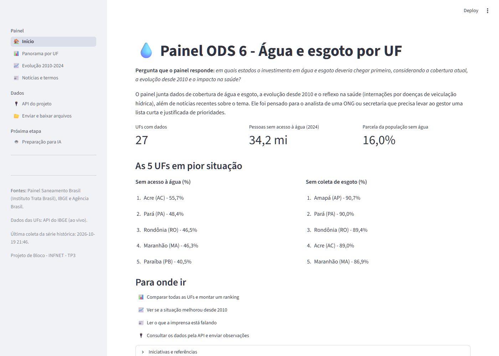
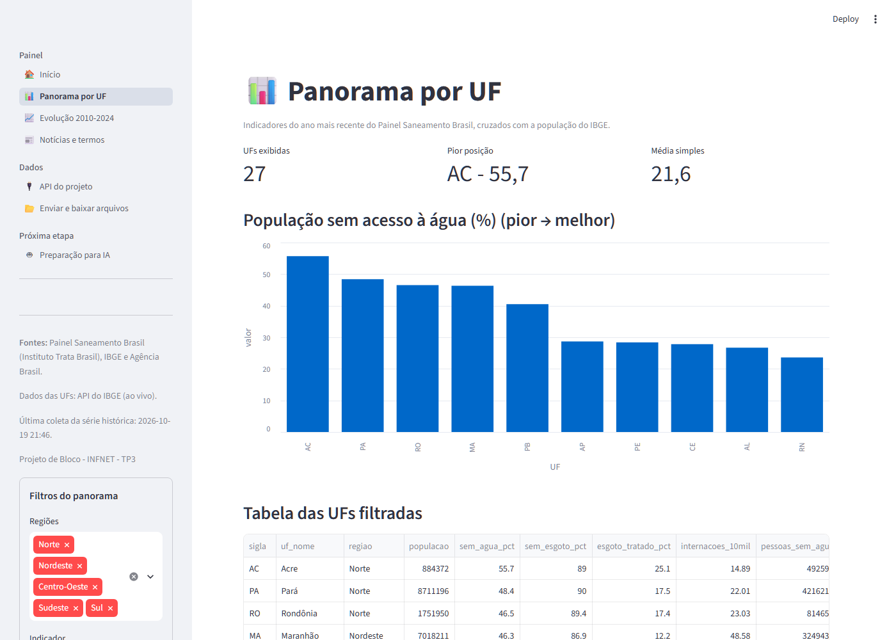
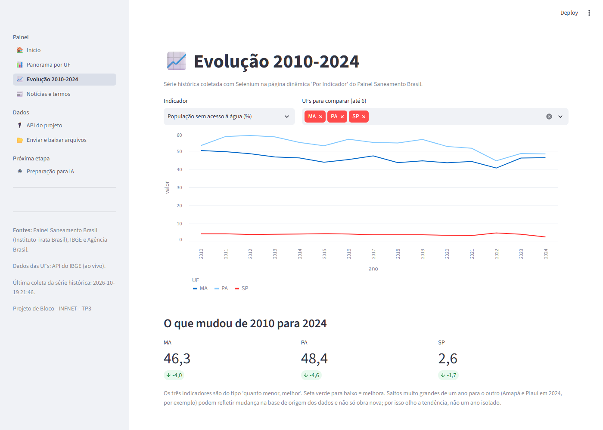
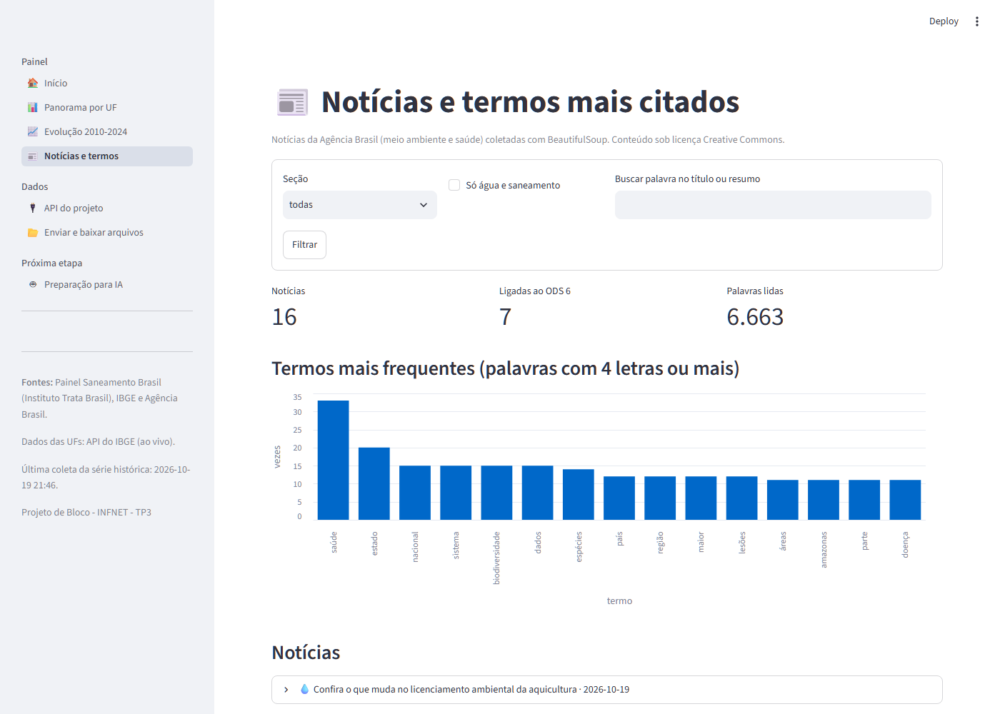
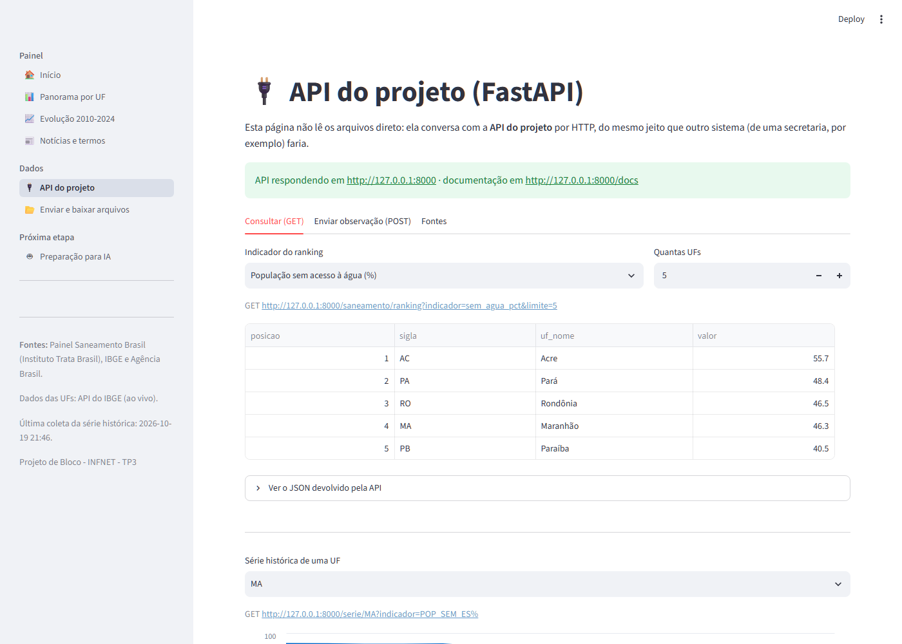
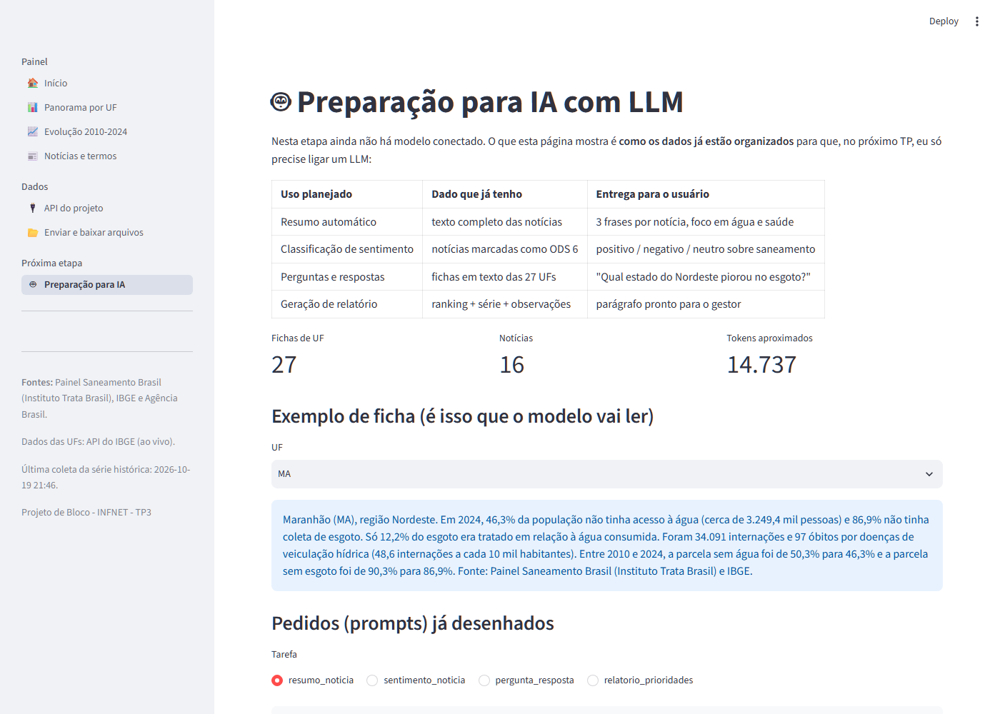

# Projeto de Bloco: Inteligência Artificial Aplicada - TP3

**Aluno:** Luis Claudio de Jesus  
**Projeto:** Painel ODS 6 - água e esgoto por UF  
**Repositório:** https://github.com/luiscjesus-infnet/4S_Projeto_de_Bloco_tp3  
**Repositórios anteriores:** TP1: https://github.com/luiscjesus-infnet/4S_Projeto_de_Bloco  
TP2: https://github.com/luiscjesus-infnet/4S_Projeto_de_Bloco_tp2

---

## O que mudou do TP2 para o TP3 (visão rápida)

| Item | TP2 | TP3 |
|---|---|---|
| Interface | uma página só, tudo empilhado | 7 páginas com menu de navegação (`st.navigation`) |
| Dados de saneamento | nenhum (só manchetes) | 8 indicadores de 2024 por UF + série 2010-2024 de 3 indicadores |
| Coleta estática | manchetes da Agência Brasil em TXT | notícias completas (data, resumo, texto) + tabela do Painel Saneamento, em CSV |
| Coleta dinâmica | - | Selenium no Painel Saneamento (formulário em cascata + rolagem infinita) |
| API própria | - | FastAPI com 7 rotas GET e 1 rota POST, documentada em `/docs` |
| Preparação para LLM | - | corpus em JSONL (fichas das UFs + notícias + observações) e prompts desenhados |

---

## 1. Revisão e Atualização da Documentação

### 1.1 Reavaliação do problema de negócio

No TP1 eu escrevi o problema de forma ampla: "falta de visibilidade centralizada dos indicadores de infraestrutura hídrica". No TP2 o painel virou um radar de notícias, mas ainda sem nenhum número de saneamento. Olhando de novo, percebi que nenhuma das versões respondia a uma pergunta que um gestor conseguisse usar para decidir.

Com as ferramentas desta etapa a pergunta ficou mais precisa:

> **Em quais UFs o investimento em água e esgoto deveria chegar primeiro, considerando a cobertura atual, a evolução desde 2010 e o impacto na saúde?**

O que cada ferramenta nova mudou no problema:

- **Selenium** me deu acesso à série histórica 2010-2024, que só existe numa página dinâmica. Com ela deixo de olhar só a foto do ano e passo a ver se a UF está melhorando ou parada. A pergunta passa de descritiva ("quem está pior?") para diagnóstica ("quem está pior e não está saindo do lugar?").
- **FastAPI** muda quem pode usar o projeto. Antes, só quem abrisse o painel. Agora, o sistema de uma secretaria ou de uma ONG consegue consumir o ranking e a série direto, sem raspar a minha página, e ainda enviar observações de campo.
- **Preparação para LLM**: com o texto completo das notícias e as fichas das UFs, a próxima etapa pode gerar o "e-mail de três linhas" que o gestor quer ler, em vez de ele ter que interpretar gráfico.

**Ajuste nas metas:** a meta do TP1 ("consolidar dados populacionais e indicadores regionais") foi trocada por metas mensuráveis ligadas à decisão (tabela de KPIs abaixo).

### 1.2 Project Charter (revisado no TP3)

| Campo | Conteúdo |
|---|---|
| **Nome** | Painel ODS 6 - água e esgoto por UF |
| **ODS atendido** | ODS 6 - Água potável e saneamento (metas 6.1 acesso à água, 6.2 esgotamento sanitário e 6.3 tratamento de efluentes). Ligação secundária com o ODS 3 (meta 3.3, doenças transmitidas pela água), por isso trago internações e óbitos por doenças de veiculação hídrica. |
| **Por que esse ODS** | Em 2024, cerca de 34 milhões de pessoas no Brasil ainda não tinham acesso à água e, na média das UFs, 58% da população não tinha coleta de esgoto. É um problema concreto, medido e com dado público. |
| **Problema** | O recurso para saneamento é limitado e a escolha de onde investir costuma ser feita sem juntar, num lugar só, cobertura, tendência e efeito na saúde. |
| **Pergunta de negócio** | Em quais UFs o investimento em água e esgoto deveria chegar primeiro, considerando cobertura atual, evolução desde 2010 e impacto na saúde? |
| **Objetivo** | Entregar um painel e uma API que mostrem, em poucos cliques, as UFs prioritárias e a justificativa com números, e que na próxima etapa gerem esse resumo em texto com LLM. |
| **Dentro do escopo** | 27 UFs; indicadores de água, esgoto e saúde; série 2010-2024; notícias recentes de meio ambiente e saúde; API de consulta e envio de observações. |
| **Fora do escopo** | Nível municipal (fica para depois, se houver tempo); previsão de investimento em reais; integração com sistemas oficiais. |
| **Usuário (quem usa)** | Analista de ONG ou de secretaria estadual/municipal que prepara material para decisão. |
| **Decisor (quem decide)** | Gestor público ou diretor da ONG que define onde o recurso vai primeiro. |
| **Stakeholders** | População das UFs com menor cobertura (beneficiária final); secretarias de saneamento e de saúde; companhias de saneamento; Instituto Trata Brasil e IBGE (fontes); órgãos de controle que acompanham o marco do saneamento. |
| **Metodologia** | TDSP. No TP3 estou entre *Data Acquisition & Understanding* (novas fontes, Selenium) e *Modeling* (ranking e preparação do corpus para LLM). O *Deployment* acontece em duas frentes: painel no Streamlit e API no FastAPI. |

**Metas e indicadores de sucesso (KPIs)**

| Meta (SMART) | Indicador | Situação no TP3 |
|---|---|---|
| Cobrir as 27 UFs com os indicadores de água, esgoto e saúde do ano mais recente até o TP3 | UFs com dado completo | 27 de 27 (2024) ✅ |
| Ter a série 2010-2024 de pelo menos 3 indicadores para todas as UFs até o TP3 | valores coletados | 1.215 de 1.215 (27 UFs × 15 anos × 3) ✅ |
| Usuário chegar ao ranking de prioridade em até 2 cliques a partir da página inicial | cliques | 1 clique (menu "Panorama por UF") ✅ |
| Disponibilizar os dados para outro sistema sem raspagem até o TP3 | rotas documentadas na API | 8 rotas (7 GET + 1 POST) ✅ |
| Atualizar todos os dados em menos de 5 minutos rodando os 3 coletores | tempo total | ~4 min (notícias ~3 min por causa do intervalo de 10 s pedido pelo site) ✅ |
| Gerar, no próximo TP, um resumo de prioridades em texto que o gestor leia em menos de 1 minuto | tamanho do texto / avaliação de 3 pessoas | planejado para o TP4 |

**Riscos e mitigação**

| Risco | Impacto | Mitigação |
|---|---|---|
| Site muda o HTML e o scraping para de funcionar | coleta quebra | coleta separada do painel; o painel lê o CSV já salvo; coletores avisam quando a tabela não tem 27 UFs |
| Selenium lento ou bloqueado | série desatualizada | espera explícita com condição clara (27 UFs); nova tentativa automática; paginação escondida do site anotada como plano B |
| API do IBGE fora do ar | painel sem população | cópia local em `ufs_ibge.json` e aviso da origem na barra lateral |
| Mudança de método na fonte (saltos em 2024 em AP e PI) | leitura errada de "melhora" | aviso na página de evolução; análise pela tendência, não por um ano isolado |
| Notícia marcada errada como "ligada ao ODS 6" | ruído na análise | regra revisada (tirei "rio") e classificação com LLM planejada para substituir a regra |
| Chave de API do LLM vazar no GitHub | custo e segurança | `.env` e `.streamlit/secrets.toml` já estão no `.gitignore` |
| Uso indevido de conteúdo raspado | questão legal | só fontes que o `robots.txt` permite; Agência Brasil é Creative Commons e guardo o link de cada notícia; HTML bruto não vai para o Git |

**Cronograma**

| Etapa | Entrega | Status |
|---|---|---|
| TP1 | problema, ODS, Charter inicial, demo Streamlit, amostra do IBGE | entregue |
| TP2 | interatividade, scraping com BeautifulSoup, cache, upload/download | entregue |
| TP3 | multipáginas, Selenium, FastAPI, documentação revisada, plano de LLM | esta entrega |
| TP4 | LLM no painel e na API (resumo, sentimento, perguntas e respostas, relatório) | próxima etapa |
| Final (dez/2026) | projeto completo + apresentação | - |

**Estrutura de pastas (alinhada ao TDSP)**

```
4S_Projeto_de_Bloco_tp3/
├── app.py                      # roteador do Streamlit (menu e estado comum)
├── paginas/                    # uma análise por arquivo
│   ├── inicio.py
│   ├── panorama.py
│   ├── evolucao.py
│   ├── noticias.py
│   ├── api_projeto.py
│   ├── arquivos.py
│   └── preparacao_ia.py
├── api/
│   └── main.py                 # API FastAPI
├── src/                        # código de apoio (não é interface)
│   ├── coleta_dinamica.py      # Selenium  -> serie_saneamento_uf.csv
│   ├── coleta_painel.py        # BeautifulSoup -> saneamento_uf.csv
│   ├── coleta_noticias.py      # BeautifulSoup -> noticias.csv
│   ├── ibge.py                 # API do IBGE -> ufs_ibge.json
│   ├── dados.py                # leitura dos processados (usada pelo painel e pela API)
│   ├── comum.py                # cache, estado da sessão, formatação
│   ├── cliente_api.py          # painel -> API
│   ├── validacao.py            # validação dos uploads
│   └── preparo_llm.py          # corpus e prompts para a próxima etapa
├── data/
│   ├── raw/                    # HTML bruto das coletas (fora do Git)
│   └── processed/              # CSV/JSON que o painel e a API leem
├── docs/                       # este documento, Charter e Data Summary
├── requirements.txt            # o que o painel precisa (vai para a nuvem)
├── requirements-coleta.txt     # + BeautifulSoup e Selenium (só local)
└── requirements-api.txt        # + FastAPI e Uvicorn
```

### 1.3 Data Summary Report (revisado no TP3)

**Fontes de dados**

| # | Fonte | Técnica | Tipo de dado | Atualização | Permissão | Por que uso | Arquivo gerado |
|---|---|---|---|---|---|---|---|
| 1 | API do IBGE (localidades e agregados, tabela 6579) | `requests` | semiestruturado (JSON) | anual | API pública | sigla, região e população de cada UF; é a "chave" que liga as outras fontes | `ufs_ibge.json` |
| 2 | Painel Saneamento Brasil - "Por ano" | `requests` + BeautifulSoup | estruturado (tabela HTML estática) | anual | `robots.txt` permite tudo | foto mais recente (2024) de água, esgoto, saúde e renda por UF | `saneamento_uf.csv` |
| 3 | Painel Saneamento Brasil - "Por indicador" | **Selenium** | estruturado, mas gerado dinamicamente | anual | `robots.txt` permite tudo | série 2010-2024 para medir tendência | `serie_saneamento_uf.csv` |
| 4 | Agência Brasil - seções Meio Ambiente e Saúde | `requests` + BeautifulSoup | não estruturado (texto) | diária | `robots.txt` permite, com 10 s entre requisições; conteúdo Creative Commons | contexto atual e texto para resumo/sentimento com LLM | `noticias.csv` |
| 5 | Usuário do painel (upload de CSV) | `st.file_uploader` | estruturado (CSV) | quando o usuário envia | dado do próprio usuário, não é gravado | cruzar um dado local (ex.: investimento previsto) com os indicadores | não grava |
| 6 | Usuário da API (POST) | FastAPI | semiestruturado (JSON) | contínua | dado enviado voluntariamente, sem dado pessoal sensível | observações de campo que viram contexto para o LLM | `observacoes.csv` |

**Fontes avaliadas e descartadas**

- **Busca da EBC (`busca.ebc.com.br`)**: seria ótima para buscar "saneamento" direto, mas o `robots.txt` dela tem `Disallow: /`. Não usei.
- **Botão "Exportar" do Painel Saneamento**: devolveu erro 500 numa requisição direta, então não serve como arquivo pronto.

**Dicionário de dados**

`saneamento_uf.csv` (27 linhas, ano 2024) - combinado com o IBGE em `src/dados.py`

| Coluna | Tipo | Descrição | Mín. | Média | Máx. |
|---|---|---|---|---|---|
| sigla | texto | UF (vem do IBGE) | - | - | - |
| regiao | texto | região (vem do IBGE) | - | - | - |
| populacao | inteiro | população estimada 2025 (IBGE) | 738.772 (RR) | 7,9 mi | 46,1 mi (SP) |
| sem_agua_pct | decimal | % da população sem acesso à água | 2,5 (DF) | 21,6 | 55,7 (AC) |
| sem_esgoto_pct | decimal | % da população sem coleta de esgoto | 6,8 (SP) | 58,4 | 90,7 (AP) |
| esgoto_tratado_pct | decimal | esgoto tratado em relação à água consumida (%) | 12,2 (MA) | 40,1 | 90,6 (RR) |
| internacoes_vh | inteiro | internações por doenças de veiculação hídrica | 874 (RR) | 12.451 | 46.198 (MG) |
| obitos_vh | inteiro | óbitos por doenças de veiculação hídrica | 0 (DF) | 176 | 999 (SP) |
| internacoes_10mil | decimal | **calculado**: internações ÷ população × 10.000 | 5,9 (RN) | 16,9 | 48,6 (MA) |
| pessoas_sem_agua | inteiro | **calculado**: população × % sem água | 74.922 (DF) | 1,27 mi | 4,22 mi (PA) |
| receita_media_agua, renda_com_saneamento, renda_sem_saneamento | decimal | R$/m³ e R$/mês | - | - | - |
| fonte, coletado_em | texto | origem e data/hora da coleta | - | - | - |

`serie_saneamento_uf.csv` (1.215 linhas, formato "longo": uma linha por UF, ano e indicador, sem valores nulos)

| Coluna | Tipo | Descrição |
|---|---|---|
| uf_nome | texto | nome da UF como aparece no site |
| ano | inteiro | 2010 a 2024 |
| indicador | texto | `POP_SEM_AG%`, `POP_SEM_ES%` ou `INCIDE_VH` |
| indicador_nome | texto | nome completo lido do título da tabela |
| valor | decimal | valor do ano (média das UFs: sem água 26,3% em 2010 → 21,6% em 2024; sem esgoto 73,0% → 58,4%; incidência de internações 42,0 → 17,0) |
| fonte, coletado_em | texto | origem e data/hora |

`noticias.csv` (16 notícias, 15 a 19/10/2026, média de 416 palavras)

| Coluna | Tipo | Descrição |
|---|---|---|
| secao | texto | meio-ambiente ou saude |
| titulo, resumo, texto | texto | título, linha fina e corpo da notícia (texto limitado a 6.000 caracteres) |
| url | texto | link original (exigência da licença) |
| publicado_em | data/hora | data de publicação |
| palavras | inteiro | tamanho do texto |
| tema_ods6 | sim/não | marcação por palavras-chave (7 de 16 marcadas) |

`observacoes.csv`: `id`, `sigla`, `autor`, `tipo` (campo/correção/sugestão), `texto`, `enviado_em`.

**Qualidade e tratamento dos dados**

- Números do site vêm no formato brasileiro ("1.234,5%"); converto para decimal na coleta.
- Os nomes das UFs vêm com acento; para juntar com o IBGE comparo sem acento e em minúsculas.
- Saltos grandes em 2024 (Amapá de 59,9% para 28,7% sem água; Piauí de 32,2% para 7,7%) provavelmente refletem mudança na base de origem, não só obra nova. Deixei isso avisado no painel.
- A marcação `tema_ods6` por palavra-chave tem limite: na primeira versão "rio" marcava notícias sobre o Rio de Janeiro; tirei a palavra, mas ainda há casos discutíveis (a notícia da COP17 entra porque cita "água" uma vez). Esse é um dos motivos para usar LLM na próxima etapa.
- O HTML bruto (`data/raw`) fica só local para conferência; o que vai para o GitHub é o dado processado.

---

## 2. Criação de uma Aplicação com Múltiplas Páginas

### 2.1 Como organizei

O `app.py` deixou de ter análise. Ele virou um **roteador**: configura a página, prepara o estado que todas as páginas usam, monta o menu e chama a página escolhida. Cada análise mora no seu arquivo dentro de `paginas/`. Usei `st.navigation` com `st.Page`, porque assim o título que aparece no menu não depende do nome do arquivo e o endereço da página não muda se eu renomear o título.

| Seção do menu | Página | O que faz (funcionalidade diferente) |
|---|---|---|
| Painel | Início | pergunta de negócio, números gerais, top 5 e atalhos (`st.page_link`) |
| Painel | Panorama por UF | ranking por indicador, filtros por região, gráfico de barras, tabela e download |
| Painel | Evolução 2010-2024 | comparador de até 6 UFs na série coletada com Selenium |
| Painel | Notícias e termos | filtros, busca, termos mais frequentes, notícias com link de origem |
| Dados | API do projeto | consulta (GET) e envio de observação (POST) pela API FastAPI |
| Dados | Enviar e baixar arquivos | upload de CSV com validação e downloads dos dados do projeto |
| Próxima etapa | Preparação para IA | fichas das UFs, prompts desenhados e download do corpus |

Decisões que tomei:

- **Filtros que sobrevivem à troca de página.** Se o usuário escolhe "Norte" no Panorama, vai para Notícias e volta, o filtro continua lá. O Streamlit apaga do `session_state` a chave de um widget que saiu da tela; regravar o valor no próprio `session_state` no roteador resolve.
- **Quem entra pelo link direto também funciona.** O estado é criado no roteador (`inicializar_estado`), antes de qualquer página. Testei abrindo cada página direto, sem passar pelo Início.
- **Cache é da aplicação, `session_state` é do usuário.** As leituras de dados ficam em `st.cache_data` (iguais para todo mundo). A lista de UFs que o usuário está comparando fica no `session_state` (é só dele).
- **Filtros em lote e caso vazio.** No Panorama, os filtros ficam num `st.form`, então a página só roda de novo quando o usuário clica em "Aplicar filtros". Se nenhum dado sobra, mostro um aviso e paro a página com `st.stop()` em vez de exibir gráfico vazio.

### 2.2 Código

`app.py` (completo):

```python
import streamlit as st

from src.comum import inicializar_estado, obter_ufs, preservar_filtros
from src.dados import info_fontes

st.set_page_config(page_title="Painel ODS 6 - Saneamento", page_icon="💧", layout="wide")

# tudo que fica antes do pg.run() roda em qualquer página
inicializar_estado()
preservar_filtros()

paginas = {
    "Painel": [
        st.Page("paginas/inicio.py", title="Início", icon="🏠", default=True),
        st.Page("paginas/panorama.py", title="Panorama por UF", icon="📊"),
        st.Page("paginas/evolucao.py", title="Evolução 2010-2024", icon="📈"),
        st.Page("paginas/noticias.py", title="Notícias e termos", icon="📰"),
    ],
    "Dados": [
        st.Page("paginas/api_projeto.py", title="API do projeto", icon="🔌"),
        st.Page("paginas/arquivos.py", title="Enviar e baixar arquivos", icon="📂"),
    ],
    "Próxima etapa": [
        st.Page("paginas/preparacao_ia.py", title="Preparação para IA", icon="🤖"),
    ],
}

pg = st.navigation(paginas)

# rodapé da barra lateral, igual em todas as páginas
_, origem_ibge = obter_ufs()
with st.sidebar:
    st.divider()
    st.caption("**Fontes:** Painel Saneamento Brasil (Instituto Trata Brasil), IBGE e Agência Brasil.")
    st.caption(f"Dados das UFs: {origem_ibge}.")
    ...

pg.run()
```

`src/comum.py` (estado compartilhado entre páginas):

```python
CHAVES_PERSISTENTES = ["regioes", "indicador_panorama", "ufs_comparadas", "indicador_serie", "secao_noticias"]

def inicializar_estado():
    padroes = {
        "regioes": list(dados.REGIOES),
        "indicador_panorama": "sem_agua_pct",
        "ufs_comparadas": ["MA", "PA", "SP"],
        "indicador_serie": "POP_SEM_AG%",
        "secao_noticias": "todas",
        "observacoes_enviadas": 0,
    }
    for chave, valor in padroes.items():
        st.session_state.setdefault(chave, valor)

def preservar_filtros():
    for chave in CHAVES_PERSISTENTES:
        if chave in st.session_state:
            st.session_state[chave] = st.session_state[chave]

@st.cache_data(ttl=3600)
def obter_saneamento():
    ufs, _ = obter_ufs()
    return dados.carregar_saneamento(ufs)
```

`paginas/panorama.py` (filtros em formulário e caso vazio):

```python
with st.sidebar.form("filtros_panorama"):
    st.markdown("**Filtros do panorama**")
    st.multiselect("Regiões", REGIOES, key="regioes")
    st.selectbox("Indicador", list(INDICADORES), format_func=INDICADORES.get, key="indicador_panorama")
    quantidade = st.slider("Quantas UFs no gráfico", 5, 27, 10)
    st.form_submit_button("Aplicar filtros")

indicador = st.session_state["indicador_panorama"]
filtradas = [l for l in linhas if l["regiao"] in st.session_state["regioes"] and l.get(indicador) is not None]

if not filtradas:
    st.warning("Nenhuma UF atende aos filtros. Selecione pelo menos uma região.")
    st.stop()
```

### 2.3 Telas

Página inicial, com o menu dividido em três seções na barra lateral:



Panorama por UF (filtros em formulário na barra lateral, ranking e tabela):



Evolução 2010-2024 (comparador de UFs com os dados coletados pelo Selenium):



Notícias e termos mais frequentes:



### 2.4 Testes que fiz

Com o `AppTest` do próprio Streamlit rodei as 7 páginas, uma a uma: nenhuma exceção. Também testei: (1) escolher só "Norte" no Panorama, ir para Notícias e voltar - o filtro continuou "Norte"; (2) desmarcar todas as regiões - apareceu o aviso e a página parou sem erro; (3) upload com sigla inválida, valor não numérico, coluna faltando e arquivo vazio - todos recusados com mensagem clara.

---

## 3. Extração de Dados de Páginas Dinâmicas (Web Scraping)

### 3.1 Precisava mesmo de Selenium?

Antes de escolher a ferramenta, segui a ordem do mais simples para o mais pesado: **API → requests + BeautifulSoup → arquivo pronto → Selenium**.

| Dado que eu queria | Existe API? | O HTML já traz o dado? | Ferramenta escolhida |
|---|---|---|---|
| UF, região, população | sim (IBGE) | - | `requests` na API |
| Indicadores de 2024 por UF | não | **sim**, a tabela inteira vem no HTML | BeautifulSoup |
| Série 2010-2024 por UF | não | **não**, só as 15 primeiras linhas | **Selenium** |
| Notícias | não | sim | BeautifulSoup |

O teste que me convenceu: fiz um `requests.get` na página "Por indicador" já com o indicador escolhido na URL e procurei a tabela com BeautifulSoup. Vieram só 15 linhas (Brasil, 5 regiões e as 9 primeiras UFs). As outras linhas entram por **rolagem infinita**, buscadas por AJAX conforme a pessoa desce a página. Além disso:

- as caixas Grupo → Subgrupo → Indicador são preenchidas por AJAX a cada escolha;
- o botão "Exportar" devolveu erro 500 numa requisição direta.

Encontrei também uma paginação escondida (`page=2`, `page=3`...) que a rolagem usa por baixo. Deixei anotada como plano B: se o Selenium um dia quebrar, dá para tentar por ela. Mas ela depende de parâmetros que não aparecem na tela e podem mudar sem aviso; o Selenium reproduz o caminho que o usuário faz de verdade (escolher no formulário e rolar a página).

### 3.2 Coleta com Selenium (`src/coleta_dinamica.py`)

Três problemas apareceram no caminho, e a solução de cada um ficou no código:

1. **O `<select>` original fica escondido** atrás de um componente visual do site; o clique direto dava "element not interactable". Passei a definir o valor e disparar o evento `change`, que é o que o componente faz.
2. **Condição de corrida.** O HTML inicial já traz todas as opções; se eu escolhia o subgrupo antes de o AJAX do grupo responder, a resposta chegava depois e apagava a minha escolha. Resolvi esperando o jQuery terminar as requisições (`jQuery.active == 0`).
3. **Eventos bloqueados no início.** O site usa um carregador do Cloudflare que só libera os eventos depois que todos os scripts rodam. Antes de escolher qualquer coisa, espero a página ficar pronta.

Para saber se a tabela está completa uso o conhecimento do domínio: **o Brasil tem 27 UFs**. A espera explícita checa 4 vezes por segundo se já existem 27 linhas de UF e, se não, rola a página para o site carregar mais. Se o tempo estourar, o indicador é descartado: prefiro uma falha visível a gravar uma tabela pela metade.

```python
TOTAL_UFS = 27  # 26 estados + DF: é assim que sei que a tabela terminou de carregar

INDICADORES = {
    "POP_SEM_AG%": ("1", "11"),   # grupo, subgrupo no formulário do site
    "POP_SEM_ES%": ("1", "11"),
    "INCIDE_VH": ("2", "21"),
}

def ajax_terminou(navegador):
    return navegador.execute_script("return window.jQuery ? jQuery.active === 0 : true;")

def escolher(navegador, id_select, valor):
    campo = navegador.find_element(By.ID, id_select)
    navegador.execute_script(
        "arguments[0].value = arguments[1];"
        "arguments[0].dispatchEvent(new Event('change', {bubbles: true}));",
        campo, valor,
    )

def tabela_com_todas_ufs(navegador):
    linhas = linhas_de_uf(navegador)
    if len(linhas) >= TOTAL_UFS:
        return linhas
    navegador.execute_script("window.scrollTo(0, document.body.scrollHeight);")  # dispara a rolagem infinita
    return False

def coletar_indicador(navegador, codigo, grupo, subgrupo):
    espera = WebDriverWait(navegador, 30, poll_frequency=0.25)
    navegador.get(PAGINA)
    espera.until(pagina_pronta)

    esperar_opcao(espera, "se-g", grupo)
    escolher(navegador, "se-g", grupo)
    espera.until(ajax_terminou)

    esperar_opcao(espera, "se-s", subgrupo)
    escolher(navegador, "se-s", subgrupo)
    espera.until(ajax_terminou)

    esperar_opcao(espera, "se-id", codigo)
    escolher(navegador, "se-id", codigo)  # aqui o próprio site envia o formulário

    espera.until(EC.presence_of_element_located((By.CSS_SELECTOR, "#explore-indicador-wrapper table tbody tr")))
    espera_longa = WebDriverWait(navegador, 60, poll_frequency=0.25)
    linhas = espera_longa.until(tabela_com_todas_ufs)
    ...
```

Antes de abrir o navegador o script lê o `robots.txt` (baixo com `requests` e uso o `robotparser`, porque o `read()` padrão usa um agente que o site bloqueia) e se identifica com um User-Agent próprio. O Chrome roda em modo *headless*.

Resultado da execução:

```
[OK] POP_SEM_AG%: 405 valores, 27 UFs, 5.8 s
[OK] POP_SEM_ES%: 405 valores, 27 UFs, 6.1 s
[OK] INCIDE_VH: 405 valores, 27 UFs, 6.1 s
Arquivo gravado em data/processed/serie_saneamento_uf.csv
```

### 3.3 Mais dados com BeautifulSoup

**Painel Saneamento - "Por ano" (`src/coleta_painel.py`).** A página tem mais de 10 MB porque traz todos os municípios. Uso o `SoupStrainer` para o BeautifulSoup ler só o `select` do ano e a tabela, e fico só com as linhas de UF. Os nomes das colunas do site são longos; troco por nomes curtos usando um trecho do título, o que torna o código menos frágil se o site mudar uma palavra.

```python
COLUNAS = [
    (r"sem acesso à água", "sem_agua_pct"),
    (r"sem coleta de esgoto", "sem_esgoto_pct"),
    (r"esgoto tratado", "esgoto_tratado_pct"),
    (r"internações", "internacoes_vh"),
    (r"óbitos", "obitos_vh"),
    ...
]

so_o_que_interessa = SoupStrainer(["select", "table"])
sopa = BeautifulSoup(resposta.text, "html.parser", parse_only=so_o_que_interessa)

for tr in tabela.select("tr.table-simple--row"):
    tipo = tr.select_one("span.type")
    if not tipo or tipo.get_text(strip=True) != "UF":
        continue
    ...
if len(linhas) != 27:
    print(f"[AVISO] Esperava 27 UFs e encontrei {len(linhas)}. Confira a página.")
```

Resultado: `27 UFs do ano 2024 gravadas` (24 s, quase tudo é download).

**Agência Brasil (`src/coleta_noticias.py`).** No TP2 eu guardava só a manchete num TXT. Agora entro em cada notícia e guardo data, resumo e texto, que serão a entrada do LLM. Respeito o `Crawl-delay: 10` do site entre cada requisição e marco se a notícia fala de água/saneamento.

```python
regras = ler_robots()
pausa = regras.crawl_delay(AGENTE) or 10

for secao in SECOES:                         # meio-ambiente e saude
    url_secao = f"{SITE}/{secao}"
    if not regras.can_fetch(AGENTE, url_secao):
        continue
    html = baixar(url_secao)
    (PASTA_BRUTOS / f"snapshot_{secao}.html").write_text(html, encoding="utf-8")
    for url in links_da_secao(html, secao)[:MAX_POR_SECAO]:
        time.sleep(pausa)
        noticia = ler_noticia(baixar(url), url, secao)

def ler_noticia(html, url, secao):
    sopa = BeautifulSoup(html, "html.parser")
    titulo = sopa.find("h1")
    data = sopa.find("meta", attrs={"property": "article:published_time"})
    resumo = sopa.find("meta", attrs={"name": "description"})
    corpo = sopa.find("div", class_="conteudo-noticia")
    ...
```

Resultado: 16 notícias (8 de meio ambiente e 8 de saúde), em cerca de 3 minutos.

### 3.4 Onde os dados ficaram

```
data/
├── raw/                          # fora do Git (.gitignore)
│   ├── snapshot_meio-ambiente.html
│   ├── snapshot_saude.html
│   └── snapshot_painel_ano.html
└── processed/                    # o que o painel e a API leem
    ├── saneamento_uf.csv         # BeautifulSoup - 27 linhas
    ├── serie_saneamento_uf.csv   # Selenium - 1.215 linhas
    ├── noticias.csv              # BeautifulSoup - 16 linhas
    ├── ufs_ibge.json             # API do IBGE - 27 UFs
    ├── observacoes.csv           # POST da API
    └── corpus_llm.jsonl          # preparação para LLM - 44 documentos
```

A coleta roda **fora** do painel, porque é lenta (o Selenium sozinho leva uns 20 s e as notícias uns 3 min). O painel só lê os arquivos processados. Por isso existem dois arquivos de requisitos: `requirements.txt` (o que o painel precisa na nuvem, sem Selenium) e `requirements-coleta.txt` (o que preciso na minha máquina para coletar).

---

## 4. Desenvolvimento de APIs com FastAPI

### 4.1 Ambiente

```
python -m venv venv
venv\Scripts\activate
pip install -r requirements-api.txt        # streamlit, requests, fastapi, uvicorn
uvicorn api.main:app --reload              # rodar na RAIZ do projeto, para o Python achar a pasta src
```

A API sobe em `http://127.0.0.1:8000` e a documentação interativa (Swagger, gerada pelo próprio FastAPI) fica em `http://127.0.0.1:8000/docs`. Lá dá para testar cada rota pelo botão "Try it out".

O painel roda em outra porta (`8501`). São dois programas: o painel é feito para pessoas, a API é feita para outros programas. Os dois leem os mesmos arquivos pela mesma camada (`src/dados.py`), então a regra de negócio (por exemplo, o que é "pior" em cada indicador) fica num lugar só.

### 4.2 Rotas

| Método | Rota | Parâmetros | O que devolve |
|---|---|---|---|
| GET | `/` | - | descrição da API e lista de rotas |
| GET | `/fontes` | - | cada conjunto de dados, técnica de coleta, nº de linhas e data |
| GET | `/saneamento` | `regiao` (opcional), `ordenar_por` | indicadores de 2024 de todas as UFs, ordenados |
| GET | `/saneamento/ranking` | `indicador`, `limite` (1 a 27) | as UFs em pior situação no indicador |
| GET | `/saneamento/{sigla}` | sigla da UF | todos os indicadores de uma UF |
| GET | `/serie/{sigla}` | `indicador`, `desde`, `ate` (2010 a 2024) | evolução ano a ano |
| GET | `/noticias` | `tema_ods6`, `secao`, `limite`, `incluir_texto` | notícias com link de origem |
| GET | `/observacoes` | `sigla` (opcional) | observações já enviadas |
| **POST** | `/observacoes` | corpo JSON: `sigla`, `autor`, `tipo`, `texto` | grava e devolve a observação criada (201) |

Validação: os tipos são declarados, então o FastAPI recusa sozinho, com erro **422** e a explicação, coisas como UF inexistente (`/saneamento/XX`), `limite=50`, ano fora de 2010-2024 ou texto com menos de 10 caracteres no POST.

Um cuidado de ordem: a rota fixa `/saneamento/ranking` é declarada **antes** de `/saneamento/{sigla}`. Se fosse depois, a palavra "ranking" seria lida como sigla e a rota nunca seria alcançada.

### 4.3 Código (trechos de `api/main.py`)

```python
Sigla = Literal["AC", "AL", "AM", "AP", "BA", "CE", "DF", "ES", "GO", "MA", "MG", "MS", "MT", "PA",
                "PB", "PE", "PI", "PR", "RJ", "RN", "RO", "RR", "RS", "SC", "SE", "SP", "TO"]

class NovaObservacao(BaseModel):
    sigla: Sigla = Field(description="UF a que a observação se refere")
    autor: str = Field(min_length=2, max_length=60)
    tipo: Literal["campo", "correcao", "sugestao"] = "campo"
    texto: str = Field(min_length=10, max_length=600)

# rota fixa declarada ANTES da rota com {sigla}
@app.get("/saneamento/ranking", tags=["Saneamento"])
def ranking_prioridade(
    indicador: Indicador = Query(default="sem_agua_pct"),
    limite: int = Query(default=5, ge=1, le=27, description="Quantas UFs devolver"),
):
    """UFs em pior situação no indicador escolhido (as candidatas a receber investimento primeiro)."""
    linhas = dados.carregar_saneamento()
    return {
        "indicador": indicador,
        "descricao": dados.INDICADORES[indicador],
        "ranking": [
            {"posicao": i + 1, "sigla": l["sigla"], "uf_nome": l["uf_nome"], "valor": l[indicador]}
            for i, l in enumerate(dados.ranking(linhas, indicador, limite))
        ],
    }

@app.get("/serie/{sigla}", tags=["Série histórica"])
def serie_uf(sigla: Sigla, indicador: IndicadorSerie = Query(default="POP_SEM_AG%"),
             desde: int = Query(default=2010, ge=2010, le=2024),
             ate: int = Query(default=2024, ge=2010, le=2024)):
    ...

@app.post("/observacoes", status_code=201, tags=["Observações"])
def criar_observacao(nova: NovaObservacao):
    registro = dados.salvar_observacao(nova.sigla, nova.autor, nova.tipo, nova.texto)
    return {"mensagem": "Observação registrada.", "observacao": registro}
```

### 4.4 Exemplos reais de uso

Consulta (GET):

```python
import requests
r = requests.get("http://127.0.0.1:8000/saneamento/ranking",
                 params={"indicador": "sem_agua_pct", "limite": 5}, timeout=10)
print(r.json())
```

```json
{"indicador": "sem_agua_pct", "descricao": "População sem acesso à água (%)",
 "ranking": [{"posicao": 1, "sigla": "AC", "uf_nome": "Acre", "valor": 55.7},
             {"posicao": 2, "sigla": "PA", "uf_nome": "Pará", "valor": 48.4},
             {"posicao": 3, "sigla": "RO", "uf_nome": "Rondônia", "valor": 46.5},
             {"posicao": 4, "sigla": "MA", "uf_nome": "Maranhão", "valor": 46.3},
             {"posicao": 5, "sigla": "PB", "uf_nome": "Paraíba", "valor": 40.5}]}
```

Envio (POST):

```python
r = requests.post("http://127.0.0.1:8000/observacoes",
                  json={"sigla": "MA", "autor": "Teste do TP3", "tipo": "sugestao",
                        "texto": "Registro de teste para validar a rota POST da API."})
```

```json
201 {"mensagem": "Observação registrada.",
     "observacao": {"id": 1, "sigla": "MA", "autor": "Teste do TP3", "tipo": "sugestao",
                    "texto": "Registro de teste para validar a rota POST da API.",
                    "enviado_em": "2026-10-19 21:55"}}
```

Entrada inválida (POST com texto curto):

```json
422 {"detail": [{"type": "string_too_short", "loc": ["body", "texto"],
                 "msg": "String should have at least 10 characters", "input": "curto"}]}
```

### 4.5 Integração do painel com a API

A página **API do projeto** não lê os arquivos direto: ela conversa com a API por HTTP, do jeito que outro sistema faria. Mostra o ranking (GET `/saneamento/ranking`), a série de uma UF (GET `/serie/{sigla}`), as fontes (GET `/fontes`) e tem um formulário que envia observações (POST `/observacoes`). Se a API estiver fora do ar - como no Streamlit Cloud, onde só o painel fica publicado - a página explica como subir a API e para, sem quebrar as outras páginas.

```python
API_URL = os.environ.get("API_URL", "http://127.0.0.1:8000")

def consultar(rota, parametros=None):
    """Devolve (dados, erro). Só um dos dois vem preenchido."""
    try:
        resposta = requests.get(f"{API_URL}{rota}", params=parametros, timeout=TEMPO_LIMITE)
        resposta.raise_for_status()
        return resposta.json(), None
    except requests.ConnectionError:
        return None, f"A API não respondeu em {API_URL}. Ela está rodando?"
    except requests.HTTPError as erro:
        return None, f"A API recusou o pedido ({erro.response.status_code}): {erro.response.text[:200]}"
```

Tela da página consumindo a API ao vivo (ranking vindo de `GET /saneamento/ranking`):



---

## 5. Preparação para Uso de Inteligência Artificial com LLMs

### 5.1 O que os dados permitem fazer com LLM

| Tarefa | Dado que já tenho | O que o usuário ganha | Como vou saber se funcionou |
|---|---|---|---|
| **Resumo automático** | texto completo das notícias (média de 416 palavras) | 3 frases por notícia, com o que importa para água e saúde | comparar com o resumo do próprio site em 10 notícias |
| **Classificação de sentimento** | notícias marcadas como ODS 6 | tom positivo / negativo / neutro em relação ao saneamento | conferir à mão uma amostra; medir acertos |
| **Classificação de tema** | todas as notícias | substituir a regra de palavras-chave, que hoje marca a notícia da COP17 só porque cita "água" uma vez | comparar com a minha marcação manual das 16 notícias |
| **Perguntas e respostas** | fichas em texto das 27 UFs + série 2010-2024 | perguntar "Qual UF do Nordeste tem menos esgoto tratado?" em vez de filtrar tabela | a resposta precisa citar UF, ano e número que existem na ficha |
| **Geração de relatório** | ranking + tendência + observações de campo | parágrafo pronto para o gestor, com as 3 UFs prioritárias | ser lido em menos de 1 minuto e não trazer número que não está nos dados |

### 5.2 O que já deixei pronto (`src/preparo_llm.py`)

1. **Fichas das UFs em texto.** Os números de cada UF viram um parágrafo curto, com a fonte junto. É isso que o modelo vai ler para responder perguntas e escrever relatórios:

   > Maranhão (MA), região Nordeste. Em 2024, 46,3% da população não tinha acesso à água (cerca de 3.249,4 mil pessoas) e 86,9% não tinha coleta de esgoto. Só 12,2% do esgoto era tratado em relação à água consumida. Foram 34.091 internações e 97 óbitos por doenças de veiculação hídrica (48,6 internações a cada 10 mil habitantes). Entre 2010 e 2024, a parcela sem água foi de 50,3% para 46,3% e a parcela sem esgoto foi de 90,3% para 86,9%. Fonte: Painel Saneamento Brasil (Instituto Trata Brasil) e IBGE.

2. **Corpus em JSONL** (`data/processed/corpus_llm.jsonl`): 44 documentos (27 fichas, 16 notícias, 1 observação), cerca de 14,7 mil tokens no total. Cabe inteiro no contexto dos modelos atuais, então no começo não preciso de banco vetorial; posso mandar as fichas relevantes junto da pergunta.

3. **Prompts já desenhados**, com a regra de responder só com base nos dados enviados (para reduzir invenção de números):

```python
PROMPTS_PLANEJADOS = {
    "resumo_noticia": (
        "Resuma a notícia abaixo em até 3 frases, em português simples, destacando "
        "o que ela tem a ver com água, esgoto ou saúde. Se não tiver relação, diga isso.\n\n{texto}"
    ),
    "sentimento_noticia": (
        "Classifique o tom da notícia em relação ao saneamento como POSITIVO, NEGATIVO ou NEUTRO "
        "e explique em uma frase. Responda em JSON com as chaves 'sentimento' e 'motivo'.\n\n{texto}"
    ),
    "pergunta_resposta": (
        "Use somente as fichas abaixo para responder. Se a resposta não estiver nelas, diga que não sabe. "
        "Cite a UF e o ano de cada número.\n\nFichas:\n{contexto}\n\nPergunta: {pergunta}"
    ),
    "relatorio_prioridades": (
        "Com base nas fichas abaixo, escreva um parágrafo para um gestor público explicando quais "
        "3 UFs deveriam receber investimento em saneamento primeiro e por quê.\n\n{contexto}"
    ),
}
```

4. **Página "Preparação para IA"** no painel, que mostra a ficha de qualquer UF, os prompts montados e permite baixar o material.

    

5. **Observações de campo pela API** (POST `/observacoes`): esse texto livre, que nenhum site tem, entra como contexto extra para o relatório.

### 5.3 Como pretendo integrar na próxima etapa

- Uma rota nova na API, `POST /perguntar`, que recebe a pergunta, separa as fichas das UFs citadas e chama o LLM com o prompt `pergunta_resposta`. O painel ganha uma página de perguntas que usa essa rota, mantendo a mesma separação de hoje (painel → API → dados).
- Resumo e sentimento rodam **uma vez por notícia, na coleta**, e ficam gravados no CSV (colunas `resumo_llm` e `sentimento`), para não pagar a mesma chamada toda vez que alguém abre a página.
- A chave do modelo fica em `.env` (API) e `.streamlit/secrets.toml` (painel), os dois já no `.gitignore`.
- Cuidados: limitar o tamanho do texto enviado, registrar quantos tokens cada chamada usa e sempre mostrar ao lado da resposta de qual ficha/notícia ela veio.

---

## Entrega final do TP3 - conferência

| Item pedido | Onde está |
|---|---|
| Menu de navegação com múltiplas páginas | `app.py` + `paginas/` (7 páginas em 3 seções) |
| API construída com FastAPI | `api/main.py` (8 rotas, `/docs`) |
| Projeto integrado com a API | página "API do projeto" + `src/cliente_api.py` (GET e POST) |
| Mais dados de páginas web com BeautifulSoup | `src/coleta_painel.py` e `src/coleta_noticias.py` |
| Dados de sites com Selenium | `src/coleta_dinamica.py` → `serie_saneamento_uf.csv` |
| Documentação atualizada (Project Charter e Data Summary Report) | item 1 deste documento e `docs/` |
| Planejamento de IA via LLM | item 5 deste documento, `src/preparo_llm.py` e página "Preparação para IA" |

## Como executar

```
python -m venv venv
venv\Scripts\activate
pip install -r requirements-coleta.txt -r requirements-api.txt

# 1) coletas (opcional: os CSV já estão em data/processed)
python -m src.ibge
python -m src.coleta_painel
python -m src.coleta_dinamica
python -m src.coleta_noticias
python -m src.preparo_llm

# 2) API (terminal 1)
uvicorn api.main:app --reload

# 3) painel (terminal 2)
streamlit run app.py
```
