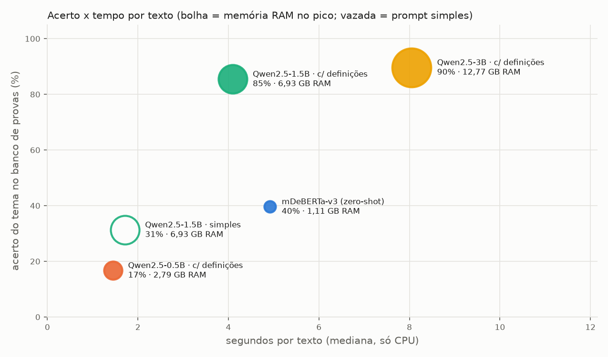
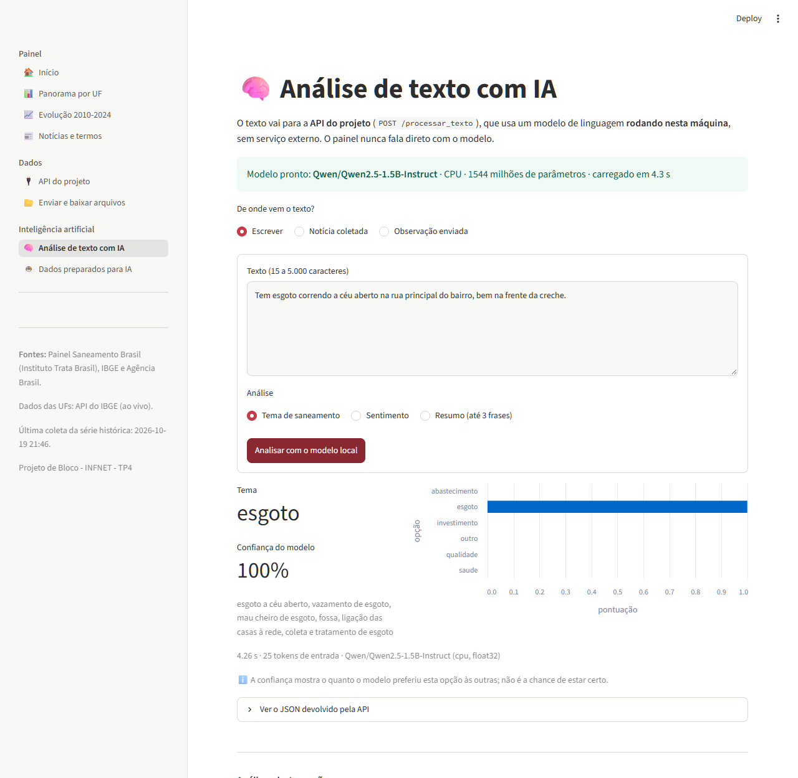
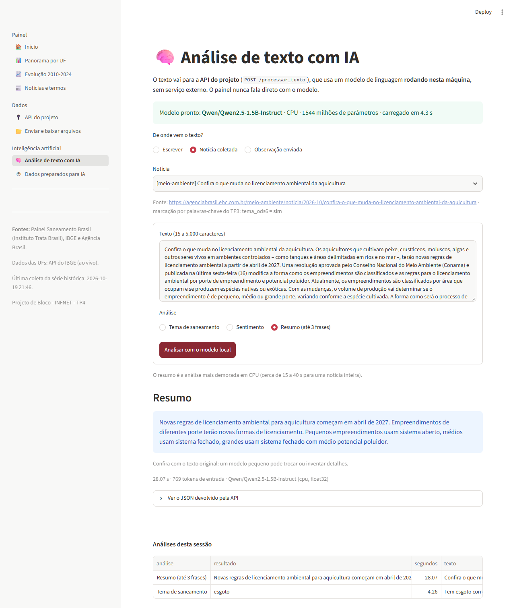
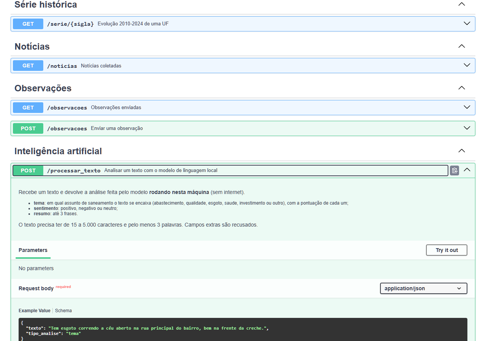
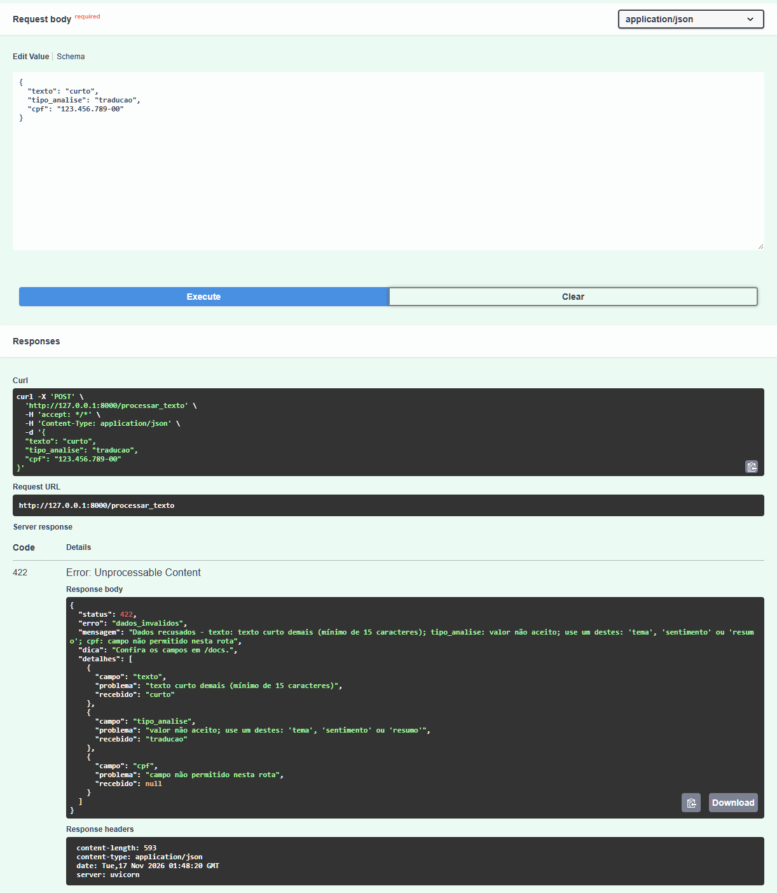

# Projeto de Bloco: Inteligência Artificial Aplicada - TP4

**Aluno:** Luis Claudio de Jesus  
**Projeto:** Painel ODS 6 - água e esgoto por UF  
**Repositório:** https://github.com/luiscjesus-infnet/4S_Projeto_de_Bloco_tp4  
**Repositórios anteriores:** TP1: https://github.com/luiscjesus-infnet/4S_Projeto_de_Bloco  
TP2: https://github.com/luiscjesus-infnet/4S_Projeto_de_Bloco_tp2  
TP3: https://github.com/luiscjesus-infnet/4S_Projeto_de_Bloco_tp3

**Declaração:** Usei um assistente de IA (Claude) como apoio na escrita e revisão do código e do texto e criação de documentações; os testes, as medições e as decisões foram conferidos por mim.

---

## O que mudou do TP3 para o TP4 (visão rápida)

| Item | TP3 | TP4 |
|---|---|---|
| IA no projeto | só planejamento (corpus e prompts desenhados) | modelo de linguagem **rodando na minha máquina** (Qwen2.5-1.5B-Instruct, HuggingFace Transformers) |
| API | 8 rotas, sem response model | 10 rotas, **todas com response model**; nova `POST /processar_texto` e `GET /modelo` |
| Erros | 404/422 padrão do FastAPI, em inglês | formato único em português (`status`, `erro`, `mensagem`, `dica`) e um código HTTP para cada cenário (422, 404, 502, 503, 504, 500) |
| Organização da API | tudo em `api/main.py` | `api/main.py` + `api/modelos.py` + `api/erros.py` + `api/rotas/` |
| Painel | 7 páginas | 8 páginas: nova **Análise de texto com IA** (tema, sentimento e resumo pela API) |
| Testes | manuais, pelo `/docs` | `/docs` + roteiro `src/testar_api.py` (21 chamadas cronometradas, incluindo pedidos simultâneos) + benchmark de 4 modelos num banco de provas rotulado |

O projeto é o mesmo do TP3, só que agora com a parte de IA ligada. Continuei no mesmo código e criei um repositório novo para esta etapa, como fiz nas anteriores.

---

## 1. Identificação e Escolha do Modelo LLM (Local)

### 1.1 O que o modelo precisa fazer no meu projeto

No TP3 planejei cinco usos para um modelo de linguagem. Nesta etapa implementei os três que trabalham sobre um texto de cada vez:

| Tarefa | Texto de entrada | Por que importa para o projeto |
|---|---|---|
| **Tema** (6 categorias: abastecimento, qualidade, esgoto, saude, investimento, outro) | notícias coletadas e observações que chegam pela API | substituir a regra de palavras-chave do TP3, que marcava como "ligada ao ODS 6" até a notícia da COP17, só porque ela cita "água" uma vez |
| **Sentimento** (positivo, negativo, neutro) | os mesmos textos | separar reclamação de boa notícia nas observações de campo |
| **Resumo** (até 3 frases) | notícia completa (média de 416 palavras) | o gestor lê o essencial sem abrir a notícia |

Perguntas e respostas sobre os dados e o relatório de prioridades para o gestor dependem de memória da conversa; ficam para a próxima entrega.

Isso já direciona a escolha: a tarefa principal é **classificar em lista fechada**, a secundária é **gerar texto curto**, e tudo em **português**.

### 1.2 Critérios e como medi cada um

Não quis escolher pelo modelo mais famoso nem pelo maior que coubesse na máquina. O model card dá uma pista, mas quem decide é o teste no meu tipo de texto.

| Critério | O que olhei | Como medi |
|---|---|---|
| **Desempenho** | acerto no meu tipo de texto, tempo de resposta e o tipo de tarefa para o qual o modelo foi treinado | banco de provas com 48 textos rotulados à mão (1.4); mediana de segundos por texto; leitura do model card |
| **Custo computacional local** | memória RAM, espaço em disco, tempo para carregar, se precisa de GPU | pico de memória do processo (`psutil`), tamanho dos pesos, cronômetro (`time.perf_counter`); tudo só em CPU |
| **Acessibilidade local** | baixa sem conta e sem token? licença permite? carrega com Transformers? entende português? | model card + download real com `huggingface_hub` + carga com `local_files_only=True` |

### 1.3 Candidatos

Olhei três famílias de modelo:

- **encoder** (família do BERT): lê o texto inteiro e dá uma nota para cada rótulo. Bom para classificar, não escreve resumo. Uso no modo *zero-shot* (o modelo foi treinado para dizer se uma frase "decorre" de outra, e eu transformo cada categoria numa frase do tipo "Este texto é sobre esgoto").
- **decoder** (família do GPT): escreve uma palavra depois da outra. Faz classificação pelo pedido (prompt) e também escreve o resumo, ou seja, **um modelo só na memória para as três tarefas**.
- **encoder-decoder** (T5, BART): lê um texto e escreve outro, bom para resumo. Para classificar eu precisaria de um segundo modelo carregado junto, o que dobra a memória; por isso não priorizei.

| Modelo | Família | Parâmetros | Licença | Acesso | Português | Situação |
|---|---|---|---|---|---|---|
| `MoritzLaurer/mDeBERTa-v3-base-mnli-xnli` | encoder (zero-shot) | 279 mi | MIT | livre | sim (treinado em 100+ idiomas) | **testado** |
| `Qwen/Qwen2.5-0.5B-Instruct` | decoder | 494 mi | Apache 2.0 | livre | sim (card cita 29+ idiomas, português incluído) | **testado** |
| `Qwen/Qwen2.5-1.5B-Instruct` | decoder | 1,54 bi | Apache 2.0 | livre | sim | **testado** |
| `Qwen/Qwen2.5-3B-Instruct` | decoder | 3,09 bi | Qwen Research (uso não comercial) | livre | sim | **testado** |
| `google/gemma-3-1b-it` | decoder | 1 bi | Gemma | exige conta e aceite de termos (*gated*) | sim | descartado por acessibilidade |
| `meta-llama/Llama-3.2-1B-Instruct` | decoder | 1,24 bi | Llama 3.2 | exige conta e aceite de termos (*gated*) | sim | descartado por acessibilidade |
| `facebook/bart-large-mnli` | encoder-decoder (zero-shot) | 407 mi | MIT | livre | **só inglês** | descartado pelo model card |

Gemma e Llama ficaram de fora porque o download exige conta no HuggingFace, aceite de termos e um token. Funciona, mas quem clonar o meu repositório não conseguiria rodar com um comando só. O BART-MNLI é o zero-shot mais baixado do Hub, mas o card diz que foi treinado só em inglês; preferi a versão multilíngue (mDeBERTa).

### 1.4 Banco de provas

Montei `data/avaliacao/banco_de_provas.csv` com **48 textos rotulados à mão** (tema e sentimento):

- **16 notícias reais** coletadas no TP3 (título + linha fina). Pelo meu critério, nenhuma é sobre água ou esgoto: falam de queimadas, chuvas, COP17, vacina, Anvisa, hospital. Todas são "outro". É justamente o caso difícil: a regra de palavras-chave do TP3 marcava 7 delas como ligadas ao ODS 6.
- **32 relatos curtos** que escrevi no estilo das observações que chegam pela API (`POST /observacoes`): 6 de cada tema de saneamento e 2 fora do tema.

| Tema | Textos | | Sentimento | Textos |
|---|---|---|---|---|
| outro | 18 | | negativo | 24 |
| abastecimento, qualidade, esgoto, saude, investimento | 6 cada | | neutro | 12 |
| | | | positivo | 12 |

```
id,origem,texto,tema,sentimento
N04,noticia_real,COP17 da Biodiversidade começa segunda-feira na Armênia. A conferência é realizada a cada dois anos...,outro,neutro
R02,relato_de_campo,O bairro Jardim Primavera está há quatro dias sem água na torneira e o caminhão-pipa não apareceu.,abastecimento,negativo
R14,relato_de_campo,"A rede coletora foi instalada, mas as casas ainda não foram ligadas e o esgoto continua indo para a fossa.",esgoto,negativo
```

**Limitação que assumo:** 48 textos é pouco. Cada erro vale cerca de 2 pontos percentuais, então diferença de um ou dois acertos entre modelos não prova nada. Além disso, ajustei o pedido (prompt) olhando para os erros neste mesmo banco (1.6), o que pode deixar o número otimista. Para a próxima entrega quero separar um segundo conjunto só para conferência.

### 1.5 Máquina e condições do teste

| Item | Valor |
|---|---|
| Sistema | Windows 11 Pro |
| Processador | Intel Core i5-11600K, 6 núcleos / 12 threads (PyTorch usou 6 threads) |
| Memória | 48 GB |
| Placa de vídeo | não usada (PyTorch só de CPU) |
| Python / PyTorch / Transformers | 3.14.7 / 2.15.0+cpu / 5.23.0 |
| Data do teste | 16/11/2026 |

A máquina tem uma placa NVIDIA RTX 3060 (12 GB), mas **medi tudo só em CPU**, de propósito: é o cenário de um computador comum, que é onde o projeto precisa rodar. Cada modelo rodou num processo separado, para a memória de um não contaminar a medida do outro. Pesos em `float32` (o item 1.6 mostra por quê).

O código do benchmark está em `src/benchmark_llm.py`. O laço principal usa o mesmo motor da API:

```python
for com_definicoes in variantes:
    variante = "prompt com definições" if com_definicoes else "prompt simples"
    for tarefa in ("tema", "sentimento"):
        for linha in banco:
            t0 = time.perf_counter()
            saida = motor._executar(tarefa, linha["texto"], com_definicoes)
            itens.append({"tarefa": tarefa, "variante": variante, "id": linha["id"], "esperado": linha[tarefa],
                          "previsto": saida["categoria"], "segundos": round(time.perf_counter() - t0, 3)})
```

e a memória é o pico do processo, lida no fim da rodada:

```python
def memoria_pico_gb():
    info = psutil.Process().memory_info()
    pico = getattr(info, "peak_wset", None) or info.rss  # peak_wset existe no Windows
    return round(pico / 1024**3, 2)
```

### 1.6 Resultados

| Modelo | Pedido (prompt) | Tema (acertos de 48) | Sentimento (de 48) | s por texto (tema) | s por texto (sentimento) | Resumo de notícia | RAM no pico | Disco | Carga |
|---|---|---|---|---|---|---|---|---|---|
| mDeBERTa-v3-base (zero-shot) | zero-shot | 19 (40%) | 26 (54%) | 4,92 | 2,37 | não faz | 1,11 GB | 0,52 GB | 1,5 s |
| Qwen2.5-0.5B-Instruct | prompt com definições | 8 (17%) | 30 (62%) | 1,45 | 0,61 | 8,5 s | 2,79 GB | 0,92 GB | 5,7 s |
| **Qwen2.5-1.5B-Instruct** | prompt com definições | 41 (85%) | 36 (75%) | 4,09 | 1,90 | 25,4 s | 6,93 GB | 2,88 GB | 7,3 s |
| **Qwen2.5-1.5B-Instruct** | prompt simples | 15 (31%) | 35 (73%) | 1,71 | 1,35 | 25,4 s | 6,93 GB | 2,88 GB | 7,3 s |
| Qwen2.5-3B-Instruct | prompt com definições | 43 (90%) | 37 (77%) | 8,05 | 3,96 | 76,4 s | 12,77 GB | 5,75 GB | 10,5 s |



O que esses números me mostraram:

1. **O pedido (prompt) pesou mais que o tamanho do modelo.** O mesmo Qwen2.5-1.5B foi de **15 para 41 acertos de tema** só trocando o pedido simples (lista de nomes) pelo pedido com a definição de cada categoria e a frase dizendo que "outro" é uma resposta normal. Com o pedido simples ele respondia "esgoto" para quase tudo, inclusive para a notícia sobre a queda do desmatamento na Amazônia. Custo: o pedido maior deixa cada texto mais lento (1,71 s para 4,1 s), porque o modelo lê mais texto a cada chamada. No sentimento a diferença foi pequena (35 para 36), porque as três opções já são autoexplicativas.
2. **"Nenhuma das anteriores" é o ponto fraco dos modelos pequenos.** Quase todos os erros caíram nas notícias que não são de saneamento. Na primeira versão do pedido, sem a frase sobre "outro", o 1.5B acertava só 28 de 48; 13 das 16 notícias viravam "esgoto", "saude" ou "investimento". Foi esse erro que me fez reescrever o pedido (e é por isso que digo, no item 1.4, que o número pode estar otimista).
3. **O zero-shot (encoder) não serviu.** O mDeBERTa é o mais leve (1,11 GB) e carrega em 1,5 s, mas acertou só 19 de 48 temas e 26 de 48 sentimentos. E nem foi rápido: ele roda uma vez para cada categoria (6 vezes por texto no tema), então gastou 4,9 s por texto. Além disso, não escreve resumo; eu precisaria de um segundo modelo na memória.
4. **O 0.5B não aguentou a tarefa.** Cabe em qualquer máquina (2,79 GB) e é o mais rápido, mas respondeu "abastecimento" para quase tudo: 8 de 48 no tema. No resumo trocou números: listou 30 °C (Belo Horizonte) e 34 °C (Cuiabá) junto com as temperaturas **mínimas**, quando no texto são as **máximas**.
5. **O 3B** acertou um pouco mais: 43 de 48 no tema e 37 no sentimento. Mas são só 2 textos de diferença para o 1.5B, pouco para um banco de 48. Em troca, usa quase o dobro de memória (12,77 GB no pico), leva o dobro do tempo por classificação (8 s) e quase 80 s por resumo, perto do limite de 90 s que coloquei na API. Os resumos dele foram os mais completos e fiéis (conferi as temperaturas citadas com o texto), mas também os mais longos e lentos. E a licença (Qwen Research) não permite uso comercial, o que pode atrapalhar se uma secretaria ou ONG quiser usar o projeto de verdade.
6. **Resumo: útil, mas precisa de conferência.** Os resumos do 1.5B ficaram fiéis ao texto, mas com ênfase às vezes errada: na notícia das chuvas ele destacou o Nordeste (uma frase só no texto) e deixou de fora o Sudeste, que está no título. E não respeitou o limite de 3 frases (numa das primeiras rodadas chegou a 8), por isso passei a cortar o excesso no código. O tempo, 25 s em média por notícia em CPU, é aceitável para um botão "resumir", não para resumir dezenas de notícias a cada abertura de página.
7. **Confiança não é chance de acerto.** O 1.5B classificou a notícia sobre doença cardiovascular como "saude" com pontuação 1,00 - errado, porque o meu "saude" é doença ligada a água ou esgoto. Por isso a API devolve a pontuação com um aviso, e não como probabilidade de acerto.

**Precisão numérica dos pesos (só no 1.5B, 6 relatos):**

| Precisão | Memória dos pesos | Acertos de tema (de 6) | s por texto |
|---|---|---|---|
| `float32` | ~5,8 GB | 6 | 4,07 |
| `bfloat16` | ~2,9 GB | 6 | 10,51 |
| `float16` | ~2,9 GB | 6 | 26,95 |

Em CPU, `float32` foi o mais rápido. Os formatos de 16 bits usam metade da memória, mas este processador não tem instruções próprias para eles, então cada conta fica mais cara. Para máquina com pouca memória, `bfloat16` é a saída (`LLM_PRECISAO=bfloat16`), sabendo que fica mais lento.

**Escolha restrita x resposta livre (1.5B, 48 textos):** deixando o modelo escrever a resposta, 2 das 48 respostas vieram fora da lista de categorias (nas duas vezes ele escreveu `outra`, que não existe na lista) e ele acertou 40 de 48. Com a escolha restrita do item 2.3 o acerto foi 41 de 48, quase igual. Ou seja, o ganho da escolha restrita não é acertar mais: é **nunca devolver uma categoria inválida** e ainda entregar a pontuação de cada opção.

### 1.7 Decisão

**Escolhi o `Qwen/Qwen2.5-1.5B-Instruct`**, em `float32`, rodando em CPU.

| Critério | Como o 1.5B ficou | Peso na decisão |
|---|---|---|
| Desempenho | 41/48 no tema (85%) e 36/48 no sentimento; resumo fiel ao texto na maior parte | o 3B acertou 2 temas a mais, diferença pequena para um banco de 48; o mDeBERTa e o 0.5B ficaram muito abaixo |
| Custo computacional | 6,9 GB de RAM no pico, 2,9 GB em disco, carrega em 7,3 s, ~4,1 s por classificação e ~25 s por resumo, **sem GPU** | cabe com folga numa máquina de 16 GB; a API continua respondendo as outras rotas enquanto ele trabalha |
| Acessibilidade | licença Apache 2.0, download sem conta nem token, carrega direto com `AutoModelForCausalLM` do Transformers, entende português | posso entregar o projeto e qualquer pessoa roda com `python -m src.baixar_modelo` |
| Um modelo para as três tarefas | classifica e resume com o mesmo modelo carregado | evita ter dois modelos na memória (classificador + resumidor) |

**O que pesa contra ele:** ainda erra 7 de 48 temas (chama de "esgoto" alguns textos sobre obras e licitações, confunde "qualidade" com "abastecimento" e classifica como "saude" notícias de doenças que não têm a ver com água), resume com ênfase às vezes errada e leva 25 s num resumo em CPU. Com GPU tudo isso cai muito, mas eu quis medir o cenário de uma máquina comum.

**Por que não o 3B, que acertou mais?** Porque os 2 acertos a mais não pagam o custo: o dobro de memória (não caberia com folga numa máquina de 16 GB com navegador e painel abertos), o dobro do tempo por classificação, resumos de quase 80 s e licença que não permite uso comercial. Deixei a troca preparada: quem tiver mais memória (ou GPU) baixa o 3B e sobe a API com `MODELO_LLM=Qwen/Qwen2.5-3B-Instruct`, sem mudar código.

Se o projeto crescer, os próximos passos naturais são: rodar na GPU (a troca é só a instalação do `torch` com CUDA), testar um modelo maior com a mesma bateria e aumentar o banco de provas, separando um conjunto só para conferência.


---

## 2. Integração de LLM com FastAPI no Ambiente Local

### 2.1 Como montei o ambiente (passo a passo)

1. **Ambiente virtual e bibliotecas.** Separei as dependências do modelo num arquivo próprio, `requirements-llm.txt`, porque o painel publicado no Streamlit Cloud não precisa de PyTorch (são centenas de MB a mais).

   ```
   python -m venv venv
   venv\Scripts\activate
   pip install -r requirements-coleta.txt -r requirements-llm.txt
   ```

   | Biblioteca | Versão que usei | Para que serve |
   |---|---|---|
   | `torch` | 2.15.0 (CPU) | motor de cálculo que roda a rede neural |
   | `transformers` | 5.23.0 | carrega o modelo e o tokenizador do HuggingFace |
   | `huggingface_hub` | - | baixa os arquivos do modelo uma vez |
   | `fastapi` / `uvicorn` / `pydantic` | 0.163.1 / - / 2.14.3 | API, servidor e validação |
   | `psutil`, `matplotlib` | - | medir memória e fazer o gráfico do benchmark |

   O `torch` que vem do PyPI no Windows é a versão **só de CPU**. Foi de propósito: quero que a API rode em qualquer computador comum. Quem tiver placa NVIDIA instala o `torch` com CUDA antes (comando no site do PyTorch) e o código usa a placa sozinho (`LLM_DISPOSITIVO=auto`). Nesta etapa eu medi e rodei tudo em CPU.

2. **Download do modelo, separado da aplicação.** Assim como a coleta de dados, baixar o modelo é lento e só precisa acontecer uma vez, então fica num script próprio. Ele grava os arquivos em `modelos/`, que está no `.gitignore` (o modelo tem ~3 GB e não vai para o GitHub; quem clonar o repositório roda o script).

   ```
   python -m src.baixar_modelo                  # Qwen2.5-1.5B-Instruct, ~3 GB
   python -m src.baixar_modelo --todos          # também os outros candidatos do benchmark
   ```

   ```python
   # src/baixar_modelo.py
   ARQUIVOS_NECESSARIOS = ["*.json", "*.safetensors", "*.model", "*.txt", "*.py"]

   def baixar(nome):
       destino = pasta_do_modelo(nome)          # modelos/Qwen__Qwen2.5-1.5B-Instruct
       snapshot_download(repo_id=nome, local_dir=destino, allow_patterns=ARQUIVOS_NECESSARIOS)
   ```

3. **Garantia de que nada vai para a nuvem.** Depois do download a internet não é mais usada. Coloquei duas travas: a API liga o modo offline do HuggingFace antes de importar qualquer coisa, e o modelo é carregado com `local_files_only=True`. Se o arquivo não estiver no disco, o carregamento falha com uma mensagem clara em vez de tentar baixar escondido.

   ```python
   # api/main.py - primeiras linhas
   os.environ.setdefault("HF_HUB_OFFLINE", "1")
   os.environ.setdefault("TRANSFORMERS_OFFLINE", "1")
   ```

4. **Subir a API e o painel** (na raiz do projeto):

   ```
   uvicorn api.main:app            # carrega o modelo em ~4,4 s e fica pronto
   streamlit run app.py            # menu "Inteligência artificial" -> "Análise de texto com IA"
   ```

### 2.2 O modelo é carregado uma vez só (`lifespan`)

Carregar o modelo do disco para a memória leva alguns segundos. Se isso acontecesse a cada pedido, cada análise ficaria lenta à toa. No FastAPI, o `lifespan` roda uma vez quando a API sobe: o modelo vai para a memória ali e fica guardado em `app.state.motor` enquanto a API estiver no ar.

Também pensei no caso de o modelo falhar (arquivo faltando, memória insuficiente). O carregamento fica dentro de um `try/except`: a API sobe do mesmo jeito, as rotas de dados do TP3 continuam funcionando e só a rota do modelo responde 503 explicando o motivo.

```python
@asynccontextmanager
async def lifespan(app: FastAPI):
    app.state.motor = None
    app.state.erro_modelo = None
    app.state.nome_modelo = os.environ.get("MODELO_LLM", MODELO_PADRAO)

    if os.environ.get("LLM_DESLIGADO") == "1":
        app.state.erro_modelo = "Modelo desligado pela variável LLM_DESLIGADO=1."
    else:
        try:
            app.state.motor = MotorLLM(
                nome=app.state.nome_modelo,
                dispositivo=os.environ.get("LLM_DISPOSITIVO", "auto"),
                precisao=os.environ.get("LLM_PRECISAO", "float32"),
            )
        except Exception as erro:  # a API sobe mesmo assim; só a rota do modelo fica indisponível
            app.state.erro_modelo = f"{type(erro).__name__}: {erro}"
            log.error("Modelo não carregou: %s", app.state.erro_modelo)
    yield
    app.state.motor = None
```

### 2.3 O motor (`src/motor_llm.py`)

Concentrei tudo que mexe com o modelo numa classe, `MotorLLM`. A API não sabe nada de PyTorch: ela só chama `motor.processar(tipo, texto)`. O mesmo motor é usado pelo benchmark, então o que eu medi no item 1 é exatamente o que roda na API.

**Tema e sentimento - escolha restrita.** Em vez de deixar o modelo escrever a resposta e depois tentar entender o que ele escreveu, eu pergunto ao modelo qual a probabilidade de ele responder cada uma das categorias permitidas, e a maior vence. Vantagens: a resposta **sempre** é uma categoria da lista e eu ganho uma pontuação para cada categoria, que o painel mostra num gráfico. Quando deixei o modelo escrever livremente, ele respondeu `outra` e, numa versão anterior do pedido, até `outrono`, que não existem na lista (item 1.6).

Na primeira versão eu olhava só o primeiro pedaço (token) de cada nome. Não ficou bom: "esgoto" começa com `es`, um pedaço muito comum em português, e isso dava vantagem falsa para essa categoria. Passei a pontuar a palavra inteira. Para não pagar o custo de rodar o modelo seis vezes, o pedido passa uma vez só, eu guardo o "rascunho" interno do modelo (o cache) e testo todas as respostas possíveis juntas, num lote, em cima dele:

```python
def _classificar(self, tarefa, texto, com_definicoes=True):
    ids_por_opcao = self._ids_tema if tarefa == "tema" else self._ids_sentimento
    entrada, truncado, tokens = self._entrada(tarefa, texto, com_definicoes)
    sequencias = [seq for variantes in ids_por_opcao.values() for seq in variantes]   # "esgoto", "Esgoto", ...
    with torch.inference_mode():
        # 1) o pedido passa pelo modelo uma vez; guardo o cache
        saida = self.modelo(**entrada, use_cache=True)
        cache = saida.past_key_values
        log_primeiro = torch.log_softmax(saida.logits[0, -1].float(), dim=-1)
        # 2) todas as respostas possíveis entram juntas, num lote, reaproveitando o cache
        ...
        cache.batch_repeat_interleave(len(sequencias))
        log_resto = torch.log_softmax(
            self.modelo(input_ids=ids, attention_mask=mascara, past_key_values=cache).logits.float(), dim=-1)
    # 3) pontuação de cada resposta = soma do log da probabilidade de cada pedaço da palavra
    ...
    # normalizo só entre as categorias permitidas (somam 1)
    normalizadas = torch.softmax(torch.stack(list(brutas.values())), dim=0).tolist()
    pontuacoes = {nome: round(p, 4) for nome, p in zip(brutas, normalizadas)}
    escolhida = max(pontuacoes, key=pontuacoes.get)
```

As categorias têm uma definição curta que vai junto no pedido (no item 1 mostro que isso fez muita diferença):

```python
TEMAS = {
    "abastecimento": "falta de água, água que não chega, rodízio, pressão baixa, caminhão-pipa, lugar sem rede de distribuição",
    "qualidade": "água suja, barrenta, com cheiro, cor ou gosto estranho, contaminação, análise da água, orientação para ferver",
    "esgoto": "esgoto a céu aberto, vazamento de esgoto, mau cheiro de esgoto, fossa, ligação das casas à rede, coleta e tratamento de esgoto",
    "saude": "doenças ligadas à água ou ao esgoto: diarreia, hepatite A, leptospirose, verminose, internações por essas causas",
    "investimento": "obras, licitações, contratos, concessões, dinheiro ou orçamento para água e esgoto, inauguração de estações",
    "outro": "o texto não trata de água encanada, esgoto nem de doenças causadas por eles (ex.: clima, ar, florestas, animais, remédios, hospitais, outras doenças)",
}
```

E, depois da lista, uma frase que deixa claro que "outro" é uma resposta normal: *"Muitos textos não falam de saneamento. Se o texto não trata de abastecimento de água, qualidade da água, esgoto, doenças causadas por água ou esgoto, ou dinheiro e obras de saneamento, a resposta é outro."*

**Resumo - geração de texto.** Aqui o modelo precisa escrever, então uso `generate` sem sorteio (`do_sample=False`, sempre a mesma resposta para o mesmo texto), com limite de tamanho e de tempo:

```python
saida = self.modelo.generate(
    **entrada,
    max_new_tokens=MAX_TOKENS_RESUMO,   # 160 tokens, dá folga para 3 frases
    do_sample=False,
    repetition_penalty=1.05,
    max_time=TEMPO_LIMITE,              # o próprio generate para se passar do limite
    pad_token_id=self.tokenizer.eos_token_id,
)
```

O pedido de resumo diz para usar no máximo 3 frases, manter nomes, lugares e números como estão e não acrescentar nada. O modelo nem sempre obedece: no benchmark ele chegou a escrever 8 frases e, no resumo da notícia das chuvas, deu destaque ao Nordeste (que aparece numa frase só do texto) e deixou de fora o Sudeste, que é o assunto do título (item 1.6). Por isso o código corta o que passar de 3 frases e o painel mostra o aviso "confira com o texto original".

### 2.4 A rota `POST /processar_texto`

```python
@roteador.post(
    "/processar_texto",
    response_model=RespostaProcessamento,
    summary="Analisar um texto com o modelo de linguagem local",
    responses=respostas_de_erro(422, 500, 502, 503, 504),
)
def processar_texto(pedido: PedidoProcessamento, request: Request):
    # o corpo já foi validado (422 vem antes); só agora confiro se o modelo está pronto (503)
    motor = obter_motor(request)
    saida = motor.processar(pedido.tipo_analise, pedido.texto)
    ...
    try:
        return RespostaProcessamento(tipo_analise=pedido.tipo_analise, ..., resultado=resultado,
                                     modelo=motor.info(), segundos=saida["segundos"], ...)
    except ValidationError as erro:
        raise RespostaInvalida(str(erro)) from erro
```

Duas decisões nessa rota:

- **`def` e não `async def`.** Com `def`, o FastAPI roda cada chamada numa thread separada. Enquanto o modelo pensa, as outras rotas continuam respondendo. Medi isso com a API real: durante um resumo de 26,0 s, um `GET /saneamento/ranking` disparado no meio respondeu em **13 ms**. Com `async def` a chamada pesada ficaria no fluxo principal e esse GET teria que esperar o resumo terminar.
- **Um pedido por vez no modelo.** O mesmo modelo atendendo dois textos ao mesmo tempo só dividiria a CPU e deixaria os dois lentos. Uma trava (`threading.Lock`) faz o segundo pedido esperar até 5 s; se o modelo continuar ocupado, ele recebe 503 com `Retry-After: 10` em vez de ficar pendurado. Aproveitei e coloquei uma trava parecida na gravação de observações (`POST /observacoes`), para dois envios simultâneos não ganharem o mesmo id.

Também criei `GET /modelo`, que diz se o modelo carregou, qual é, onde roda e, se falhou, o motivo. O painel consulta essa rota antes de mostrar o formulário.

### 2.5 Ajustes para o hardware local

| Ajuste | Onde | Por quê |
|---|---|---|
| Pesos em `float32` | `LLM_PRECISAO` (padrão) | em CPU foi o mais rápido; `bfloat16`/`float16` economizam memória mas ficaram muito mais lentos (item 1.6) |
| Só CPU por padrão; GPU se existir | `LLM_DISPOSITIVO=auto` | roda em qualquer máquina; com CUDA instalado usa a placa sem mudar código |
| Texto cortado em 1.024 tokens | `LLM_MAX_TOKENS_ENTRADA` | textos enormes estourariam tempo e memória; a resposta avisa `texto_truncado: true` |
| Resumo com no máximo 160 tokens | `LLM_MAX_TOKENS_RESUMO` | limita o tempo de geração, que é a parte mais lenta em CPU |
| Tempo limite de 90 s por análise | `LLM_TEMPO_LIMITE` | passou disso, a API devolve 504 em vez de deixar o usuário esperando |
| Um pedido por vez no modelo | trava no `MotorLLM` | evita dois pedidos disputando a CPU |
| Modelo trocável | `MODELO_LLM` | dá para usar outro modelo já baixado em `modelos/` (por exemplo o 3B, em máquina com mais memória) sem mexer no código |
| Meia precisão para pouca memória | `LLM_PRECISAO=bfloat16` | metade da memória, para máquinas de 8 GB; mais lento (item 1.6). O 0.5B não é saída: acertou só 8 de 48 temas |
| Subir sem o modelo | `LLM_DESLIGADO=1` | para testar ou rodar só as rotas de dados |

### 2.6 Integração com o painel

A página nova **Análise de texto com IA** (`paginas/analise_ia.py`) segue a mesma arquitetura do TP3: o painel fala com a API, a API fala com o modelo. O painel nunca carrega o modelo.

- o texto pode ser digitado, vir de uma **notícia coletada** (com a marcação por palavras-chave do TP3 ao lado, para comparar) ou de uma **observação enviada** pela API;
- tema e sentimento aparecem com a confiança e um gráfico com a pontuação de cada opção;
- o resumo aparece com o aviso para conferir com o original;
- as análises da sessão ficam numa tabela (`st.session_state`);
- se a API estiver fora do ar ou o modelo não tiver carregado, a página explica o que fazer e as outras páginas continuam funcionando.

```python
# src/cliente_api.py
TEMPO_LIMITE_LLM = 120   # um pouco mais que o limite da API (90 s), para receber o 504 dela

def processar_texto(texto, tipo_analise):
    """POST /processar_texto. Devolve (resultado, erro); só um dos dois vem preenchido."""
    try:
        resposta = requests.post(f"{API_URL}/processar_texto",
                                 json={"texto": texto, "tipo_analise": tipo_analise},
                                 timeout=TEMPO_LIMITE_LLM)
    except requests.ConnectionError:
        return None, f"A API não respondeu em {API_URL}. Ela está rodando?"
    except requests.Timeout:
        return None, f"A API não respondeu em {TEMPO_LIMITE_LLM} s. Tente um texto menor."
    if resposta.status_code != 200:
        return None, _mensagem_de_erro(resposta)     # usa "mensagem" e "dica" do erro padrão
    return resposta.json(), None
```

Tema de um relato digitado (pontuação de cada categoria no gráfico):



Resumo de uma notícia coletada no TP3 (a marcação por palavras-chave do TP3 aparece embaixo da notícia, para comparar) e a tabela com as análises da sessão:



---

## 3. Manipulação das Respostas da API

### 3.1 Response models

Todos os modelos de entrada, saída e erro ficam em `api/modelos.py`. Funciona como um contrato: quem consome a API olha ali (ou no `/docs`, que é gerado a partir dali) e sabe o formato exato de cada resposta. **Todas as 10 rotas** declaram `response_model`, inclusive as que vieram do TP3, então o FastAPI confere cada resposta antes de enviar.

Entrada da rota nova:

```python
class PedidoProcessamento(BaseModel):
    model_config = ConfigDict(
        extra="forbid",               # campo a mais é recusado (evita dado pessoal entrar sem querer)
        str_strip_whitespace=True,    # espaços nas pontas não contam no tamanho
        json_schema_extra={"examples": [{"texto": "Tem esgoto correndo a céu aberto ...", "tipo_analise": "tema"}]},
    )
    texto: str = Field(min_length=15, max_length=5000, description="Texto a analisar (15 a 5.000 caracteres)")
    tipo_analise: TipoAnalise = Field(default="tema", description="tema, sentimento ou resumo")

    @field_validator("texto")
    @classmethod
    def precisa_ter_palavras(cls, valor):
        if len(re.findall(r"[A-Za-zÀ-ÿ]{2,}", valor)) < 3:
            raise ValueError("o texto precisa ter pelo menos 3 palavras")
        return valor
```

Saída: um envelope igual para as três análises (texto processado, tipo de análise, modelo, tempo) e um `resultado` cujo formato depende do tipo. Uso uma união com discriminador (`tipo`), então o `/docs` mostra os três formatos possíveis e o Pydantic sabe qual validar.

```python
Tema = Literal["abastecimento", "qualidade", "esgoto", "saude", "investimento", "outro"]
Sentimento = Literal["positivo", "negativo", "neutro"]

class ResultadoTema(BaseModel):
    tipo: Literal["tema"] = "tema"
    categoria: Tema
    descricao: str
    confianca: float = Field(ge=0, le=1, description="Pontuação da categoria escolhida (não é chance de acerto)")
    pontuacoes: dict[Tema, float]

class ResultadoSentimento(BaseModel):
    tipo: Literal["sentimento"] = "sentimento"
    sentimento: Sentimento
    confianca: float = Field(ge=0, le=1)
    pontuacoes: dict[Sentimento, float]

class ResultadoResumo(BaseModel):
    tipo: Literal["resumo"] = "resumo"
    resumo: str = Field(min_length=10, max_length=1200)
    frases: int = Field(ge=1)
    tokens_gerados: int = Field(ge=1)

Resultado = Annotated[Union[ResultadoTema, ResultadoSentimento, ResultadoResumo], Field(discriminator="tipo")]

class RespostaProcessamento(BaseModel):
    tipo_analise: TipoAnalise
    texto_processado: str
    caracteres: int
    tokens_entrada: int
    texto_truncado: bool
    resultado: Resultado
    modelo: InfoModelo              # nome, dispositivo (cpu/cuda), precisão
    segundos: float
    processado_em: datetime
    aviso: Optional[str] = None

    @model_validator(mode="after")
    def tipo_bate_com_resultado(self):
        if self.resultado.tipo != self.tipo_analise:
            raise ValueError(f"pedido de '{self.tipo_analise}', mas o resultado é de '{self.resultado.tipo}'")
        return self
```

Para garantir que a lista de categorias da API e a do motor nunca fiquem diferentes, `api/modelos.py` confere isso ao ser importado (`assert set(Tema.__args__) == set(TEMAS)`): se alguém mudar uma e esquecer a outra, a API nem sobe.

### 3.2 Exemplos reais de resposta

Todos gerados com a API rodando na minha máquina (CPU), com o Qwen2.5-1.5B-Instruct.

**Tema** de um relato de campo:

```
POST /processar_texto
{"texto": "Tem esgoto correndo a céu aberto na rua principal do bairro, bem na frente da creche.", "tipo_analise": "tema"}
```

Resposta (HTTP 200, 3,6 s):

```json
{
  "tipo_analise": "tema",
  "texto_processado": "Tem esgoto correndo a céu aberto na rua principal do bairro, bem na frente da creche.",
  "caracteres": 85,
  "tokens_entrada": 25,
  "texto_truncado": false,
  "resultado": {
    "tipo": "tema",
    "categoria": "esgoto",
    "descricao": "esgoto a céu aberto, vazamento de esgoto, mau cheiro de esgoto, fossa, ligação das casas à rede, coleta e tratamento de esgoto",
    "confianca": 1.0,
    "pontuacoes": {
      "esgoto": 1.0,
      "abastecimento": 0.0,
      "qualidade": 0.0,
      "saude": 0.0,
      "investimento": 0.0,
      "outro": 0.0
    }
  },
  "modelo": {
    "nome": "Qwen/Qwen2.5-1.5B-Instruct",
    "dispositivo": "cpu",
    "precisao": "float32"
  },
  "segundos": 3.57,
  "processado_em": "2026-11-16T22:11:16",
  "aviso": "A confiança mostra o quanto o modelo preferiu esta opção às outras; não é a chance de estar certo."
}
```

**Sentimento** do mesmo relato:

```
{"texto": "Tem esgoto correndo a céu aberto ...", "tipo_analise": "sentimento"}
```

Resposta (HTTP 200, 1,7 s):

```json
{
  "tipo_analise": "sentimento",
  "texto_processado": "Tem esgoto correndo a céu aberto na rua principal do bairro, bem na frente da creche.",
  "caracteres": 85,
  "tokens_entrada": 25,
  "texto_truncado": false,
  "resultado": {
    "tipo": "sentimento",
    "sentimento": "negativo",
    "confianca": 0.9988,
    "pontuacoes": {
      "negativo": 0.9988,
      "neutro": 0.001,
      "positivo": 0.0002
    }
  },
  "modelo": {
    "nome": "Qwen/Qwen2.5-1.5B-Instruct",
    "dispositivo": "cpu",
    "precisao": "float32"
  },
  "segundos": 1.68,
  "processado_em": "2026-11-16T22:11:17",
  "aviso": "A confiança mostra o quanto o modelo preferiu esta opção às outras; não é a chance de estar certo."
}
```

**Resumo** de uma notícia coletada no TP3 (451 palavras):

```
{"texto": "<título + texto completo da notícia>", "tipo_analise": "resumo"}
```

Resposta (HTTP 200, 17,3 s):

```json
{
  "tipo_analise": "resumo",
  "texto_processado": "Desmatamento cai 41,8% na Amazônia e 23,8% no Cerrado em um ano. O desmatamento caiu 41,8% na Amazônia e 23,8% no Cerrado entre agosto de 2025 e julho de 2026,  [...]",
  "caracteres": 2849,
  "tokens_entrada": 795,
  "texto_truncado": false,
  "resultado": {
    "tipo": "resumo",
    "resumo": "Desmatamento cai 41,8% na Amazônia e 23,8% no Cerrado em um ano. Resultado é fruto de políticas de combate ao desmatamento. Ministério do Meio Ambiente comemora.",
    "frases": 3,
    "tokens_gerados": 58
  },
  "modelo": {
    "nome": "Qwen/Qwen2.5-1.5B-Instruct",
    "dispositivo": "cpu",
    "precisao": "float32"
  },
  "segundos": 17.3,
  "processado_em": "2026-11-16T22:11:35",
  "aviso": null
}
```

(cortei o `texto_processado` aqui para não repetir a notícia inteira)

**Tema** da notícia da COP17, que a regra de palavras-chave do TP3 marcava como ligada ao ODS 6 só porque cita "água" uma vez:

Resposta (HTTP 200, 3,6 s):

```json
{
  "tipo_analise": "tema",
  "texto_processado": "COP17 da Biodiversidade começa segunda-feira na Armênia. A conferência é realizada a cada dois anos e tem como objetivo debater estratégias e firmar acordos para enfrentar a crise global da perda de biodiversidade.",
  "caracteres": 214,
  "tokens_entrada": 56,
  "texto_truncado": false,
  "resultado": {
    "tipo": "tema",
    "categoria": "outro",
    "descricao": "o texto não trata de água encanada, esgoto nem de doenças causadas por eles (ex.: clima, ar, florestas, animais, remédios, hospitais, outras doenças)",
    "confianca": 1.0,
    "pontuacoes": {
      "outro": 1.0,
      "abastecimento": 0.0,
      "qualidade": 0.0,
      "esgoto": 0.0,
      "saude": 0.0,
      "investimento": 0.0
    }
  },
  "modelo": {
    "nome": "Qwen/Qwen2.5-1.5B-Instruct",
    "dispositivo": "cpu",
    "precisao": "float32"
  },
  "segundos": 3.58,
  "processado_em": "2026-11-16T22:11:38",
  "aviso": "A confiança mostra o quanto o modelo preferiu esta opção às outras; não é a chance de estar certo."
}
```

### 3.3 Validação: o que entra e o que sai

| O que é validado | Como | Se falhar |
|---|---|---|
| texto de 15 a 5.000 caracteres, com pelo menos 3 palavras | `Field(min_length, max_length)` + `field_validator` | 422 |
| tipo de análise existe | `Literal["tema", "sentimento", "resumo"]` | 422 |
| nenhum campo além de `texto` e `tipo_analise` | `extra="forbid"` | 422 |
| espaços sobrando não contam | `str_strip_whitespace=True` | - |
| **categoria devolvida pelo modelo está na lista** | `Tema` / `Sentimento` como `Literal` no response model | **502** |
| **resumo não veio vazio nem gigante** | `min_length=10`, `max_length=1200` | **502** |
| pontuações e confiança entre 0 e 1 | `Field(ge=0, le=1)` | 502 |
| tipo do resultado é o mesmo que foi pedido | `model_validator` | 502 |
| respostas das rotas de dados (TP3) | `response_model` em todas | 500 (erro meu, não do cliente) |

O ponto que mais me preocupava é a **saída** do modelo. Modelo de linguagem pode inventar. Por isso a resposta do modelo passa pelo mesmo contrato antes de sair: se viesse uma categoria que não existe, ela seria descartada com 502 em vez de chegar ao cliente. Com a escolha restrita do item 2.3 isso não deveria acontecer, mas a validação fica como cinto de segurança, caso um dia eu troque o modelo ou o jeito de perguntar.

Outro cuidado: a resposta traz `confianca` e o aviso *"A confiança mostra o quanto o modelo preferiu esta opção às outras; não é a chance de estar certo."* No benchmark o modelo errou alguns textos com confiança alta, então não quero que o usuário leia 95% como "95% de chance de estar certo".

### 3.4 Documentação automática (`/docs`)

Cada rota tem título (`summary`), descrição (a docstring da função), exemplo de corpo e a lista de respostas de erro possíveis com o modelo `Erro`, tudo aparecendo no Swagger.



---

## 4. Tratamento Robusto de Erros na API

### 4.1 Cenários e códigos

Todo erro sai no mesmo formato, para o programa cliente tratar pelo campo `erro` e a pessoa ler `mensagem` e `dica`:

```json
{"status": 503, "erro": "modelo_indisponivel",
 "mensagem": "O modelo de linguagem não está carregado, então esta análise não pode ser feita agora.",
 "dica": "Veja o motivo em GET /modelo. As rotas de dados continuam funcionando normalmente.",
 "detalhes": null}
```

| Cenário | Código | `erro` | O que o usuário lê |
|---|---|---|---|
| texto curto/longo, sem palavras, análise inexistente, campo extra | **422** | `dados_invalidos` | qual campo e o problema, em português |
| UF, indicador ou ano inválido nas rotas de dados | **422** | `dados_invalidos` | lista de valores aceitos |
| rota ou dado inexistente | **404** | `nao_encontrado` | "A rota ... não existe." + "Veja as rotas em /docs" |
| arquivo do modelo não está no disco | **503** | `modelo_nao_encontrado` | rodar `python -m src.baixar_modelo` |
| modelo não carregou na subida (ou foi desligado) | **503** | `modelo_indisponivel` | ver o motivo em `GET /modelo`; o resto da API funciona |
| modelo ocupado com outro pedido | **503** + `Retry-After: 10` | `modelo_ocupado` | tentar de novo em alguns segundos |
| faltou memória para rodar o modelo | **503** | `sem_memoria` | fechar programas ou usar modelo menor |
| modelo passou do tempo limite | **504** | `tempo_esgotado` | enviar texto menor |
| modelo devolveu algo fora do formato | **502** | `resposta_invalida_do_modelo` | tentar de novo |
| qualquer outra falha | **500** | `erro_interno` | mensagem genérica; o detalhe vai só para o log |

Escolhi 503 para "o serviço do modelo não está disponível agora" (problema temporário do lado do servidor, não do pedido), 504 para "demorou demais" e 502 para "o componente que responde atrás da API (o modelo) devolveu uma resposta ruim". O 500 fica só para o que eu não previ. Em nenhum caso o rastro do Python (traceback) vai para o usuário.

### 4.2 Como está no código

O motor levanta erros com nomes próprios (`ModeloNaoEncontrado`, `MotorOcupado`, `TempoEsgotado`, `SemMemoria`, `RespostaInvalida`...). A API tem um tradutor central em `api/erros.py` que transforma cada um no código HTTP e na mensagem certa. A rota não precisa de um monte de `try/except`.

```python
MAPA_ERROS_MOTOR = {
    ModeloNaoEncontrado: (503, "modelo_nao_encontrado", "O modelo de linguagem não foi encontrado nesta máquina.",
                          "Rode python -m src.baixar_modelo e reinicie a API. As outras rotas continuam funcionando."),
    MotorOcupado:        (503, "modelo_ocupado", "O modelo está terminando outro pedido.",
                          "Tente de novo em alguns segundos."),
    TempoEsgotado:       (504, "tempo_esgotado", "O modelo demorou mais que o limite para responder.",
                          "Envie um texto menor ou tente de novo. Resumos de textos longos são os mais demorados."),
    RespostaInvalida:    (502, "resposta_invalida_do_modelo",
                          "O modelo respondeu, mas a resposta veio fora do formato esperado e foi descartada.",
                          "Tente de novo; se repetir, reformule o texto."),
    ...
}

@app.exception_handler(ErroDoMotor)
async def erro_do_motor(request: Request, exc: ErroDoMotor):
    status, codigo, mensagem, dica = MAPA_ERROS_MOTOR.get(type(exc), (500, "erro_no_modelo", "Falha ao usar o modelo.", None))
    headers = {"Retry-After": "10"} if isinstance(exc, MotorOcupado) else None
    return resposta_erro(status, codigo, mensagem, dica, headers=headers)

@app.exception_handler(RequestValidationError)
async def erro_de_validacao(request: Request, exc: RequestValidationError):
    detalhes = [{"campo": ..., "problema": _traduzir(item), "recebido": _valor_recebido(item)} for item in exc.errors()]
    resumo = "; ".join(f"{d['campo']}: {d['problema']}" for d in detalhes)
    return resposta_erro(422, "dados_invalidos", f"Dados recusados - {resumo}", "Confira os campos em /docs.", detalhes=detalhes)

@app.exception_handler(Exception)
async def erro_inesperado(request: Request, exc: Exception):
    log.exception("Erro inesperado em %s %s", request.method, request.url.path)   # rastro só no log
    return resposta_erro(500, "erro_interno", "Aconteceu um erro inesperado ao processar o pedido.",
                         "Tente de novo. Se continuar, avise o responsável pela API.")
```

As mensagens de validação do Pydantic vêm em inglês; traduzi as mais comuns (`string_too_short`, `extra_forbidden`, `literal_error`, `missing`...) para o usuário final entender.

O tempo limite e a fila ficam no motor. A análise roda numa thread de trabalho; se passar de 90 s, a API responde 504. Como uma thread não pode ser interrompida no meio de uma conta, a trava do modelo só é liberada quando ela de fato termina, para o próximo pedido não disputar a CPU com a análise abandonada:

```python
def processar(self, tarefa, texto, com_definicoes=True):
    if not self._trava.acquire(timeout=ESPERA_NA_FILA):
        raise MotorOcupado("O modelo está ocupado com outro pedido.")
    futuro = None
    try:
        futuro = self._executor.submit(self._executar, tarefa, texto, com_definicoes)
        return futuro.result(timeout=TEMPO_LIMITE)
    except TempoDoFuturoEsgotado:
        raise TempoEsgotado(f"A análise passou de {TEMPO_LIMITE:.0f} s.") from None
    except (torch.OutOfMemoryError, MemoryError) as erro:
        raise SemMemoria(str(erro)) from erro
    finally:
        if futuro is not None and not futuro.done():
            futuro.add_done_callback(lambda _: self._trava.release())
        else:
            self._trava.release()
```

Uma ordem que fiz questão de garantir: **o pedido é validado antes de conferir o modelo**. Se o texto é inválido e o modelo está fora do ar, o usuário recebe 422 (o problema é o texto dele), não 503.

### 4.3 Exemplos reais de erro

**Texto curto demais (422):**

```
{"texto": "curto", "tipo_analise": "tema"}
```

Resposta (HTTP 422, 0,0 s):

```json
{
  "status": 422,
  "erro": "dados_invalidos",
  "mensagem": "Dados recusados - texto: texto curto demais (mínimo de 15 caracteres)",
  "dica": "Confira os campos em /docs.",
  "detalhes": [
    {
      "campo": "texto",
      "problema": "texto curto demais (mínimo de 15 caracteres)",
      "recebido": "curto"
    }
  ]
}
```

**Análise que não existe + campo extra com CPF (422, os dois problemas de uma vez):**

```
{"texto": "Tem esgoto ...", "tipo_analise": "traducao", "cpf": "123.456.789-00"}
```

Resposta (HTTP 422, 0,0 s):

```json
{
  "status": 422,
  "erro": "dados_invalidos",
  "mensagem": "Dados recusados - tipo_analise: valor não aceito; use um destes: 'tema', 'sentimento' ou 'resumo'; cpf: campo não permitido nesta rota",
  "dica": "Confira os campos em /docs.",
  "detalhes": [
    {
      "campo": "tipo_analise",
      "problema": "valor não aceito; use um destes: 'tema', 'sentimento' ou 'resumo'",
      "recebido": "traducao"
    },
    {
      "campo": "cpf",
      "problema": "campo não permitido nesta rota",
      "recebido": null
    }
  ]
}
```

**Só números (422):**

```
{"texto": "12345 67890 12345 67890"}
```

Resposta (HTTP 422, 0,0 s):

```json
{
  "status": 422,
  "erro": "dados_invalidos",
  "mensagem": "Dados recusados - texto: o texto precisa ter pelo menos 3 palavras",
  "dica": "Confira os campos em /docs.",
  "detalhes": [
    {
      "campo": "texto",
      "problema": "o texto precisa ter pelo menos 3 palavras",
      "recebido": "12345 67890 12345 67890"
    }
  ]
}
```

**Modelo ocupado (503 + Retry-After)** - enviei um tema enquanto o modelo resumia uma notícia longa:

Resposta (HTTP 503 · retry-after: 10, 5,0 s):

```json
{
  "status": 503,
  "erro": "modelo_ocupado",
  "mensagem": "O modelo está terminando outro pedido.",
  "dica": "Tente de novo em alguns segundos.",
  "detalhes": null
}
```

**Tempo esgotado (504)** - subi a API com `LLM_TEMPO_LIMITE=5` e pedi o resumo de uma notícia longa:

Resposta (HTTP 504, 5,0 s):

```json
{
  "status": 504,
  "erro": "tempo_esgotado",
  "mensagem": "O modelo demorou mais que o limite para responder.",
  "dica": "Envie um texto menor ou tente de novo. Resumos de textos longos são os mais demorados.",
  "detalhes": null
}
```

**Modelo não encontrado (503)** - subi a API com `MODELO_LLM=Qwen/Modelo-Que-Nao-Baixei`. A API subiu, `GET /modelo` mostra o motivo e as rotas de dados continuam respondendo:

```
GET /modelo
```

Resposta (HTTP 200, 0,0 s):

```json
{
  "carregado": false,
  "nome": "Qwen/Modelo-Que-Nao-Baixei",
  "dispositivo": null,
  "precisao": null,
  "parametros_milhoes": null,
  "segundos_carregando": null,
  "analises": [
    "tema",
    "sentimento",
    "resumo"
  ],
  "tempo_limite_s": 90.0,
  "max_tokens_entrada": 1024,
  "erro": "ModeloNaoEncontrado: O modelo Qwen/Modelo-Que-Nao-Baixei não está em modelos/Qwen__Modelo-Que-Nao-Baixei/. Rode: python -m src.baixar_modelo Qwen/Modelo-Que-Nao-Baixei"
}
```

```
POST /processar_texto
```

Resposta (HTTP 503, 0,0 s):

```json
{
  "status": 503,
  "erro": "modelo_indisponivel",
  "mensagem": "O modelo de linguagem não está carregado, então esta análise não pode ser feita agora.",
  "dica": "Veja o motivo em GET /modelo. As rotas de dados continuam funcionando normalmente.",
  "detalhes": null
}
```

`GET /saneamento/MA` na mesma API: **HTTP 200** em 8 ms.

### 4.4 Do lado do usuário

No painel, cada erro vira uma frase com o que fazer, montada a partir de `mensagem` e `dica`. Exemplos que aparecem na página:

- API desligada: *"A API não respondeu em http://127.0.0.1:8000. Ela está rodando?"* + o comando para subir;
- modelo não carregado: aviso amarelo com o motivo vindo de `GET /modelo`;
- texto curto: *"(422) Dados recusados - texto: texto curto demais (mínimo de 15 caracteres) Confira os campos em /docs."*

### 4.5 Testes que fiz

Testei de dois jeitos, sempre com a API real e o modelo carregado.

**1. Pelo `/docs`, com o "Try it out".** Para cada rota mandei pedidos certos e errados e conferi o código e a mensagem. Exemplo: um pedido com três problemas ao mesmo tempo (texto curto, análise que não existe e um campo `cpf` que não faz parte da rota). A API recusa com 422 e lista os três, em português. O valor do CPF não volta na resposta (`"recebido": null`), porque um campo recusado pode ser justamente um dado pessoal.



**2. Com um roteiro em Python (`src/testar_api.py`).** Ele faz pela linha de comando o que eu faria no `/docs` e mais duas coisas difíceis de fazer no navegador: cronometrar a mesma chamada várias vezes e disparar um pedido enquanto o modelo está ocupado com outro. Com a API rodando num terminal, no outro:

```
python -m src.testar_api
```

```
API em http://127.0.0.1:8000

1) Situação do modelo
  carregado=True  Qwen/Qwen2.5-1.5B-Instruct  cpu  float32  carregou em 4.3 s

2) Cronômetro: o mesmo relato 3 vezes em cada análise
  tema, chamada 1                            200    3.90 s  OK       esgoto
  tema, chamada 2                            200    3.63 s  OK       esgoto
  tema, chamada 3                            200    3.86 s  OK       esgoto
  sentimento, chamada 1                      200    1.73 s  OK       negativo
  sentimento, chamada 2                      200    1.77 s  OK       negativo
  sentimento, chamada 3                      200    1.71 s  OK       negativo
  tema da notícia da COP17 (esperado: outro) 200    4.04 s  OK       outro
  resumo de notícia inteira                  200   17.68 s  OK       Desmatamento cai 41,8% na Amazônia e 23,8% no Cerrado em um ano. Resultado é fruto de polí

3) Entradas inválidas (esperado: 422 com a explicação)
  texto curto                                422    0.01 s  OK       dados_invalidos
  só números                                 422    0.01 s  OK       dados_invalidos
  texto com 5.001 caracteres                 422    0.02 s  OK       dados_invalidos
  análise que não existe                     422    0.01 s  OK       dados_invalidos
  campo a mais (cpf)                         422    0.02 s  OK       dados_invalidos
  corpo vazio                                422    0.01 s  OK       dados_invalidos

4) Rotas de dados (não dependem do modelo)
  ranking                                    200    0.01 s  OK       
  UF que não existe (XX)                     422    0.01 s  OK       dados_invalidos
  série com desde > ate                      422    0.01 s  OK       dados_invalidos
  rota que não existe                        404    0.01 s  OK       nao_encontrado

5) Dois pedidos ao mesmo tempo
  GET durante o resumo (deve responder já)   200    0.01 s  OK       
  tema durante o resumo (modelo ocupado)     503    5.03 s  OK       modelo_ocupado
                                             Retry-After: 10
  o resumo que estava rodando                200   25.86 s  OK       O governo monitora saúde dos amazonenses afetados por queimadas. Ministério atua com visit

21 de 21 chamadas com o código esperado.
```

O que esse resultado confirma:

- o mesmo texto deu a mesma resposta nas 3 chamadas, em tempo parecido (~3,8 s no tema e ~1,7 s no sentimento);
- a notícia da COP17, que a regra de palavras-chave do TP3 marcava como ligada ao ODS 6, saiu como "outro";
- toda entrada inválida volta 422 na hora (centésimos de segundo), sem gastar o modelo;
- o GET feito **durante** um resumo de 26 s respondeu em centésimos de segundo (efeito da rota com `def`, item 2.4), e o segundo pedido ao modelo recebeu 503 com `Retry-After: 10` depois de esperar 5 s na fila.

Os dois cenários que dependem de como a API sobe eu testei subindo a API de novo com uma variável de ambiente, e as respostas reais estão no item 4.3:

| Cenário | Como subi a API | Resultado |
|---|---|---|
| tempo esgotado | `set LLM_TEMPO_LIMITE=5` e pedi o resumo de uma notícia longa | 504 `tempo_esgotado` em 5 s |
| modelo que não está no disco | `set MODELO_LLM=Qwen/Modelo-Que-Nao-Baixei` | a API subiu; `GET /modelo` mostra o motivo; `POST /processar_texto` dá 503 e `GET /saneamento/MA` continua 200 |

O código do roteiro (trecho):

```python
def conferir(titulo, resposta, segundos, esperado):
    corpo = resposta.json()
    if resposta.status_code == 200 and "resultado" in corpo:
        r = corpo["resultado"]
        detalhe = r.get("categoria") or r.get("sentimento") or r.get("resumo", "")[:90]
    else:
        detalhe = corpo.get("erro") or corpo.get("mensagem") or ""
    situacao = "OK" if resposta.status_code == esperado else f"DIFERENTE (esperava {esperado})"
    conferidos.append(resposta.status_code == esperado)
    print(f"  {titulo:<42} {resposta.status_code}  {segundos:6.2f} s  {situacao:<8} {detalhe}")

print("2) Cronômetro: o mesmo relato 3 vezes em cada análise")
for tipo in ("tema", "sentimento"):
    for vez in range(1, 4):
        conferir(f"{tipo}, chamada {vez}", *processar(RELATO, tipo), esperado=200)
...
print("5) Dois pedidos ao mesmo tempo")
tarefa = threading.Thread(target=resumo_longo)
tarefa.start()
time.sleep(2)  # dá tempo de o resumo começar
conferir("GET durante o resumo (deve responder já)", *chamar("GET", "/saneamento/ranking"), esperado=200)
resposta, segundos = processar(RELATO)
conferir("tema durante o resumo (modelo ocupado)", resposta, segundos, esperado=503)
```

---

## Entrega final do TP4 - conferência

| Item pedido | Onde está |
|---|---|
| Integração funcional com modelo LLM local (HuggingFace) | `src/motor_llm.py`, `api/main.py` (`lifespan`), `api/rotas/llm.py` (`POST /processar_texto`) e página "Análise de texto com IA" |
| Respostas consistentes com Response Models | `api/modelos.py`; `response_model` nas 10 rotas (item 3) |
| Tratamento robusto de erros com exceções HTTP adequadas | `api/erros.py` e `MotorLLM.processar` (item 4); testes em `/docs` e `src/testar_api.py` (item 4.5) |
| Documentação que justifica a escolha do modelo | item 1 (benchmark em `src/benchmark_llm.py`, dados em `data/avaliacao/`) |
| Descrição de como a integração local foi feita | item 2 (ambiente, bibliotecas, download, ajustes de hardware) |

## Como executar

```
python -m venv venv
venv\Scripts\activate
pip install -r requirements-coleta.txt -r requirements-llm.txt

# 1) baixar o modelo (uma vez, ~3 GB)
python -m src.baixar_modelo

# 2) API (terminal 1) - carrega o modelo e fica pronta
uvicorn api.main:app

# 3) painel (terminal 2)
streamlit run app.py

# testes e benchmark (opcionais)
python -m src.testar_api          # com a API rodando no outro terminal
python -m src.baixar_modelo --todos
python -m src.benchmark_llm
python -m src.grafico_benchmark
```

## Fontes consultadas

- Documentação do FastAPI: *Lifespan Events*, *Response Model*, *Handling Errors*, *Concurrency and async / await* (https://fastapi.tiangolo.com)
- Documentação do Pydantic v2: *Models*, *Fields*, *Validators*, *Unions (discriminated unions)* (https://docs.pydantic.dev)
- Documentação do HuggingFace Transformers: *Text generation*, *Chat templates*, *Pipelines - zero-shot classification* (https://huggingface.co/docs/transformers)
- Model cards: Qwen2.5-0.5B/1.5B/3B-Instruct, mDeBERTa-v3-base-mnli-xnli, gemma-3-1b-it, Llama-3.2-1B-Instruct (https://huggingface.co)
- Dados: Painel Saneamento Brasil (Instituto Trata Brasil), IBGE e Agência Brasil, como no TP3
- Usei um assistente de IA como apoio na escrita e revisão do código e do texto; os testes, as medições e as decisões foram conferidos por mim.
