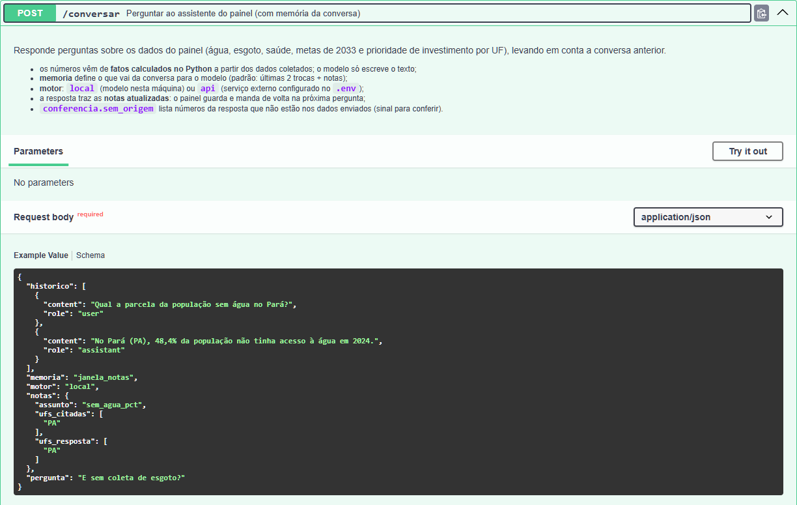
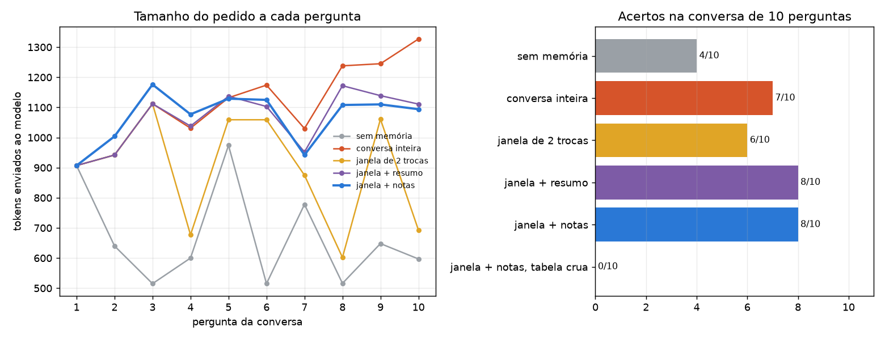
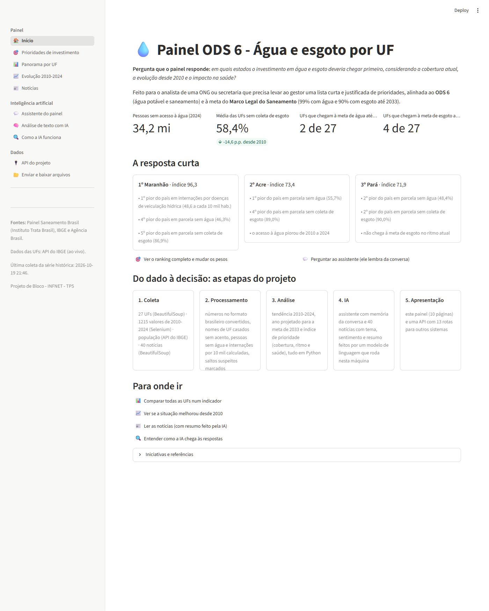
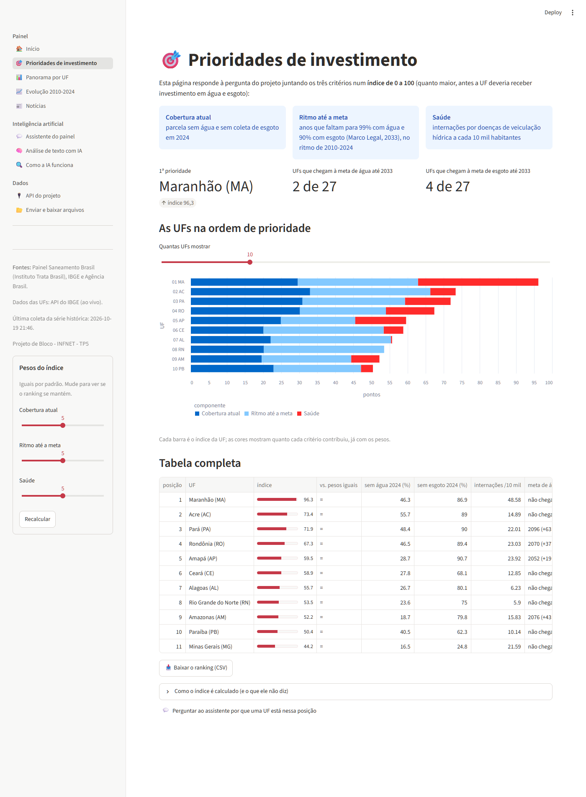
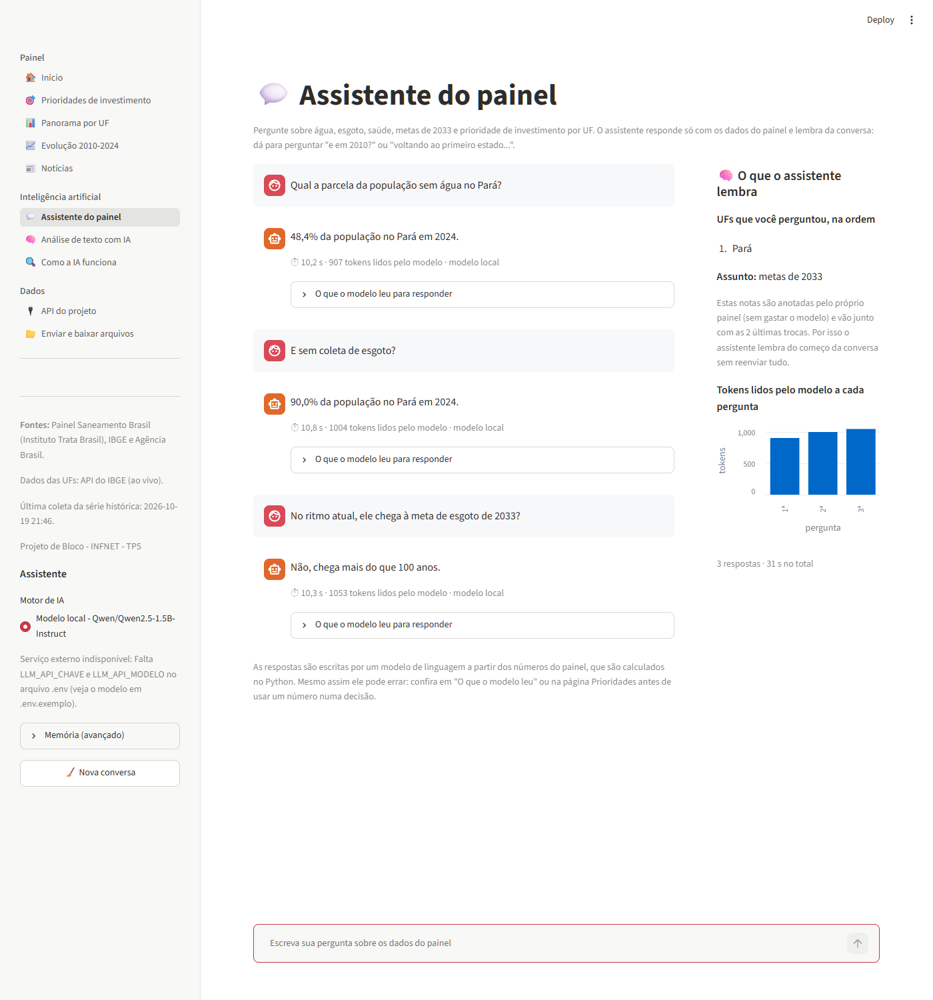
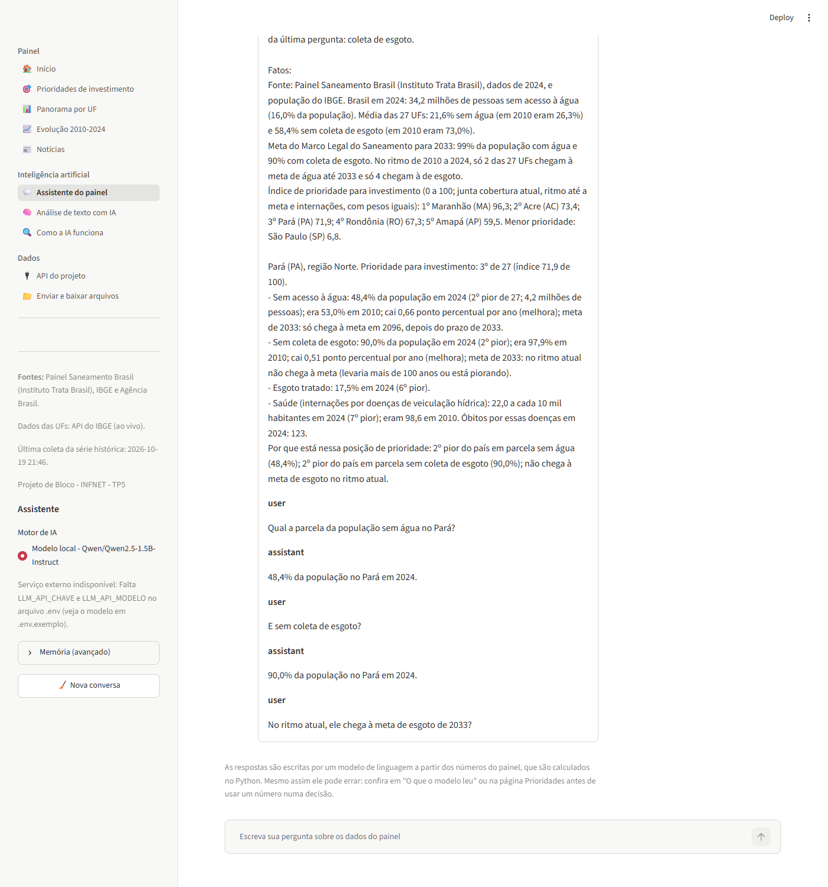
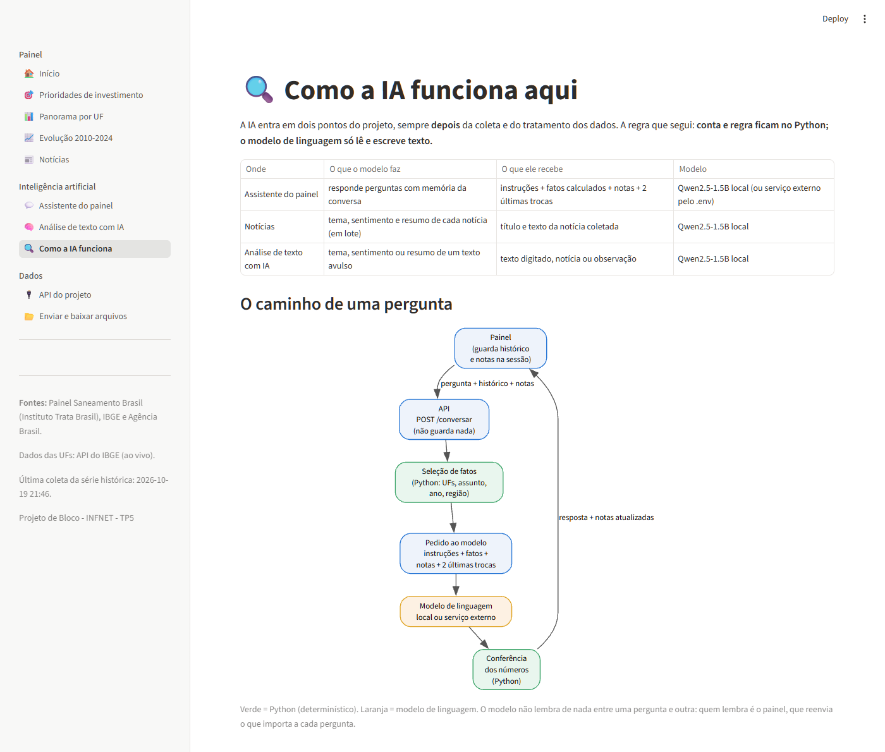
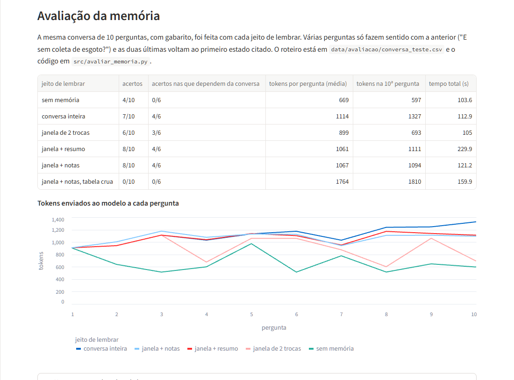
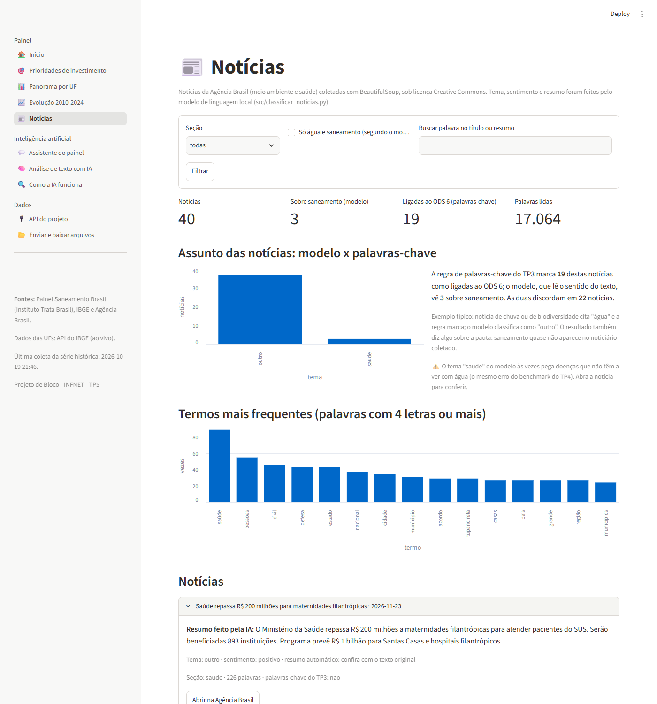

# Projeto de Bloco: Inteligência Artificial Aplicada - TP5

**Aluno:** Luis Claudio de Jesus  
**Projeto:** Painel ODS 6 - água e esgoto por UF  
**Repositório:** https://github.com/luiscjesus-infnet/4S_Projeto_de_Bloco_tp5  
**Repositórios anteriores:** TP1: https://github.com/luiscjesus-infnet/4S_Projeto_de_Bloco  
TP2: https://github.com/luiscjesus-infnet/4S_Projeto_de_Bloco_tp2  
TP3: https://github.com/luiscjesus-infnet/4S_Projeto_de_Bloco_tp3  
TP4: https://github.com/luiscjesus-infnet/4S_Projeto_de_Bloco_tp4

**Declaração:** Usei um assistente de IA (Claude) como apoio na escrita e revisão do código e do texto e na criação de documentações; os testes, as medições e as decisões foram conferidos por mim.

---

## O que mudou do TP4 para o TP5 (visão rápida)

| Item | TP4 | TP5 |
|---|---|---|
| Pergunta do projeto | respondida por rankings separados (um por indicador) | respondida por um **índice de prioridade** que junta cobertura, ritmo até a meta de 2033 e saúde |
| Análise | indicadores de 2024 e série 2010-2024 lado a lado | **tendência** de 15 anos, **ano projetado para a meta** do Marco Legal do Saneamento e marcação de saltos suspeitos |
| IA | tema, sentimento e resumo de um texto por vez | **assistente com memória da conversa** (Opção 1) + tema, sentimento e resumo de **todas** as notícias, em lote |
| Motor de IA | só o modelo local | modelo local (padrão) **ou** serviço externo compatível com a OpenAI, escolhido no painel |
| API | 10 rotas | 13 rotas: novas `POST /conversar`, `GET /motores` e `GET /prioridades` |
| Painel | 8 páginas | 10 páginas: novas **Prioridades**, **Assistente do painel** e **Como a IA funciona**; Início com o ciclo de ciência de dados |
| Notícias | 16, de uma coleta | 40, base acumulada (a coleta junta as novas sem repetir) |
| Testes | benchmark do modelo (48 textos) + roteiro da API | + **avaliação da memória** (conversa de 10 perguntas com gabarito, 6 rodadas) + provedor simulado para testar os erros do serviço externo |
| Artefatos do TDSP | Charter e Data Summary do TP3 com ajustes | Charter e Data Summary revisados para o ciclo completo |

O projeto é o mesmo desde o TP1. Continuei no mesmo código e criei um repositório novo para esta etapa, como fiz nas anteriores. O primeiro commit é o estado em que o TP4 foi entregue.

---

## 1. Atualização e Completação dos Artefatos do TDSP

### 1.1 Onde está cada artefato

| Artefato do TDSP | Arquivo | O que mudou no TP5 |
|---|---|---|
| **Project Charter** | [`docs/project_charter.md`](project_charter.md) | objetivo e escopo do produto final, ligação com ESG, seção "como os dados, a IA e a engenharia de prompt resolvem o problema", KPIs do assistente com o resultado medido, riscos novos (alucinação, conversa longa, serviço externo, privacidade), etapas do TDSP |
| **Data Summary Report** (com o dicionário de dados) | [`docs/data_summary_report.md`](data_summary_report.md) | tabela de como cada dado coletado foi integrado e onde é usado; dados derivados (tendência, metas, índice); dados produzidos pela IA e pela avaliação; problemas de qualidade novos (saltos na série) |
| Relatório do modelo | item 1 do documento do TP4 (escolha do modelo) e itens 2.3 a 2.8 deste documento (fatos, prompt, memória, avaliação) | avaliação da memória e comparação "fatos x tabela crua" |
| Relatório final (aceite) | item 4 deste documento e a tabela "Entrega final do TP5 - conferência" | - |

### 1.2 Data Summary Report: como os dados de API e scraping foram integrados

Resumo do que está no relatório (seção 2 de `data_summary_report.md`). O caminho é sempre o mesmo: **a coleta grava em `data/`, `src/dados.py` lê e junta, `src/analise.py` calcula, e o painel, a API e a IA consomem**. Nenhuma tela raspa nada na hora e o modelo de linguagem nunca recebe dado cru.

| Dado coletado | Técnica | O que passou a gerar no TP5 | Onde aparece |
|---|---|---|---|
| UFs e população | API do IBGE (`requests`) | chave de junção; pessoas sem água; internações por 10 mil | todas as páginas, fichas do assistente |
| Indicadores de 2024 (27 UFs) | BeautifulSoup | componentes **cobertura** e **saúde** do índice | Prioridades, Panorama, `/prioridades` |
| Série 2010-2024 (1.215 valores) | Selenium | **tendência**, **ano da meta de 2033**, componente **ritmo**, saltos suspeitos | Prioridades, Evolução, fichas do assistente |
| Notícias (40) | BeautifulSoup | **tema, sentimento e resumo pelo modelo local** | Notícias, Análise de texto com IA |
| Tudo acima | `src/fatos.py` | **fatos em texto** que o assistente lê | Assistente do painel, `/conversar` |

A junção das três fontes acontece numa função só, que monta o "perfil" de cada UF. É dele que saem o índice, as metas e os fatos do assistente:

```python
# src/analise.py
def perfis_das_ufs(saneamento=None, serie=None):
    saneamento = saneamento if saneamento is not None else dados.carregar_saneamento()   # BeautifulSoup + IBGE
    serie = serie if serie is not None else dados.carregar_serie()                       # Selenium
    por_uf = {}
    for p in serie:
        por_uf.setdefault(p["sigla"], {}).setdefault(p["indicador"], []).append((p["ano"], p["valor"]))

    perfis = {}
    for linha in saneamento:
        sigla = linha["sigla"]
        pontos = por_uf.get(sigla, {})
        agua, esgoto, incid = pontos.get("POP_SEM_AG%", []), pontos.get("POP_SEM_ES%", []), pontos.get("INCIDE_VH", [])
        inc_agua, inc_esgoto = tendencia(agua), tendencia(esgoto)
        ano_agua, sit_agua = ano_da_meta(linha["sem_agua_pct"], inc_agua, META_SEM_AGUA)
        ano_esgoto, sit_esgoto = ano_da_meta(linha["sem_esgoto_pct"], inc_esgoto, META_SEM_ESGOTO)
        perfis[sigla] = {**linha, "tendencia_agua": inc_agua, "tendencia_esgoto": inc_esgoto,
                         "meta_agua_ano": ano_agua, "meta_agua_situacao": sit_agua, ...,
                         "quebras": sorted(set(quebras_na_serie(agua) + quebras_na_serie(esgoto)))}
    return perfis
```

A coleta de notícias passou a **acumular**: as notícias de coletas anteriores ficam e só entram as novas, comparando pelo link. Assim a base cresce a cada execução (de 16 para 40 nesta entrega) sem repetir nada:

```python
# src/coleta_noticias.py
links = {n["url"] for n in anteriores}
novas = [{**n, "fonte": "Agência Brasil (CC BY)", "coletado_em": coletado_em} for n in noticias if n["url"] not in links]
todas = sorted(anteriores + novas, key=lambda n: n["publicado_em"], reverse=True)
```

O dicionário de dados completo (colunas, tipos, mínimo, média e máximo, inclusive dos campos derivados) está na seção 3 do relatório. Um ponto de qualidade novo que a análise revelou: **13 UFs têm pelo menos um ano com salto de mais de 10 pontos** de um ano para o outro (ex.: Amapá de 59,9% para 28,7% sem água em 2024). Por isso a tendência usa a reta dos 15 anos e não só o primeiro e o último ano, e a ficha que o assistente lê avisa o salto.

### 1.3 Project Charter: dados, IA e engenharia de prompt alinhados ao problema

O argumento principal, que coloquei no Charter, é que o problema tem duas partes e cada uma pede uma ferramenta:

1. **Decidir a ordem das UFs** é conta: tendência, projeção, normalização, pesos. Precisa ser exata e auditável, então ficou em Python. Nenhuma parte da decisão depende do modelo de linguagem.
2. **Explicar e explorar a decisão** é linguagem: o analista quer perguntar "por que o Maranhão?", depois "e em 2010?", depois "e o Pará?". Aqui o modelo de linguagem com memória da conversa ajuda.

A engenharia de prompt liga as duas partes: o Python entrega ao modelo os **fatos já calculados**, escolhidos para cada pergunta, com instruções para não fazer contas e para dizer quando o dado não existe. Isso foi medido (item 2.8): com a mesma memória, o modelo acertou **8 de 10** perguntas recebendo os fatos e **0 de 10** recebendo a tabela crua.

KPIs novos do Charter, com o resultado medido:

| Meta | Resultado |
|---|---|
| Assistente acertar pelo menos 8 de 10 perguntas encadeadas | 8 de 10 (modelo local, CPU) ✅ |
| Tamanho do pedido não crescer com a conversa | 907 → 1.094 tokens (1,2×); na conversa inteira, 907 → 1.327 (1,5×) e subindo ✅ |
| Resposta em até 30 s numa máquina comum (só CPU) | mediana de 11,6 s na conversa de teste ✅ |
| Toda notícia com tema e resumo automáticos | 40 de 40 ✅ |

### 1.4 O ciclo completo de ciência de dados no projeto

| Etapa do TDSP | O que fiz (TP1 ao TP5) | Código e artefatos |
|---|---|---|
| Entendimento do negócio | pergunta afiada, público (analista) x decisor (gestor), ODS 6 e 3, KPIs, riscos | Project Charter |
| Aquisição e entendimento dos dados | API do IBGE; BeautifulSoup (indicadores e notícias); Selenium (série); limpeza, junção, dicionário | `src/coleta_*.py`, `src/ibge.py`, `src/dados.py`, Data Summary Report |
| Modelagem | tendência e projeção da meta; índice de prioridade; escolha do modelo de linguagem por benchmark (TP4); escolha da memória por avaliação (TP5) | `src/analise.py`, `src/benchmark_llm.py`, `src/avaliar_memoria.py`, `data/avaliacao/` |
| Implantação | painel Streamlit com 10 páginas; API FastAPI com 13 rotas; modelo local ou serviço externo | `app.py`, `paginas/`, `api/` |
| Aceite | testes da API e da conversa, conferência com a rubrica, limites assumidos | itens 2.8, 2.10 e 4 deste documento |

---

## 2. Escolha de um Caminho para a Solução Final com LLMs: Opção 1 - memória conversacional

### 2.1 Por que a memória conversacional

Escolhi a **Opção 1** porque ela é o que faltava no projeto. No TP4 o modelo já resumia e classificava (a Opção 2 estava parcialmente feita), mas cada texto era tratado sozinho. Quem usa o painel não faz uma pergunta só: faz uma sequência ("qual a situação do Pará?", "e o esgoto?", "e em 2010?"). Sem memória, a segunda pergunta já não tem sentido para o modelo. Isso estava previsto desde o TP3 ("perguntas e respostas" no corpus planejado) e ficou registrado no TP4 como próxima etapa.

**Local ou API?** Implementei os dois, com o **modelo local como padrão**:

| | Modelo local (Qwen2.5-1.5B-Instruct, CPU) | Serviço externo (formato OpenAI) |
|---|---|---|
| Custo | zero | depende do plano; os gratuitos têm limite de uso |
| Privacidade | nada sai da máquina | a pergunta e os fatos vão para outra empresa |
| Velocidade | ~12 s por resposta curta, 20 a 40 s numa explicação de 3 frases | segundos, quando não está no limite |
| Qualidade | boa com fatos prontos; erra em 2 de 10 perguntas da conversa de teste | modelos maiores, em geral melhores |
| Disponibilidade | sempre (não tem fila nem 429) | pode responder 429, ficar lento ou fora do ar |
| Continuidade com o TP4 | o mesmo modelo escolhido no benchmark | - |

A escolha do padrão local vem do TP4 (benchmark, licença Apache 2.0, roda em qualquer máquina) e de um argumento do próprio problema: a ONG ou secretaria pode querer usar o painel com observações de campo, e o padrão mais seguro é nada sair da máquina. O serviço externo fica como opção para quem quer mais velocidade, configurado só no `.env`.

### 2.2 Arquitetura: quem lembra é o painel

O modelo não lembra de nada entre uma chamada e outra. Quem lembra é o painel: a conversa fica no `st.session_state` e, a cada pergunta, o painel manda à API o histórico e as **notas** da conversa. A API monta o pedido, chama o modelo e devolve a resposta com as notas atualizadas. A API não guarda nada; assim várias pessoas conversam ao mesmo tempo sem uma ver a conversa da outra, e nenhuma conversa fica gravada no servidor.

```
Painel (session_state: histórico + notas)
   │  POST /conversar  {pergunta, historico, notas, memoria, motor}
   ▼
API ──► seleção de fatos (Python) ──► pedido: instruções + fatos + notas + 2 últimas trocas
                                                   │
                                                   ▼
                                   modelo (local ou serviço externo)
                                                   │
   ◄── resposta + notas atualizadas ◄── conferência dos números (Python)
```

No painel (`paginas/assistente.py`):

```python
st.session_state.setdefault("chat_mensagens", [])    # o que aparece na tela (com as medidas de cada resposta)
st.session_state.setdefault("chat_notas", None)      # notas devolvidas pela API na última resposta
...
resposta, erro = cliente_api.conversar(
    pergunta, st.session_state["chat_mensagens"], st.session_state["chat_notas"], memoria=memoria, motor=motor)
if erro:
    st.error(erro)                       # a pergunta não entra no histórico: dá para tentar de novo
else:
    st.session_state["chat_mensagens"] += [
        {"role": "user", "content": pergunta},
        {"role": "assistant", "content": resposta["resposta"], "info": resposta},
    ]
    st.session_state["chat_notas"] = resposta["notas"]
```

### 2.3 Dos dados aos fatos: contas no Python, texto no modelo

Tudo o que é conta fica em `src/analise.py`:

- **Tendência**: inclinação da reta de 2010 a 2024 (mínimos quadrados), em pontos percentuais por ano. Olha a série inteira, então um salto isolado pesa menos do que se eu usasse só 2010 e 2024.
- **Meta de 2033** (Lei 14.026/2020: 99% com água e 90% com coleta de esgoto): em que ano a UF chega lá mantendo o ritmo.
- **Índice de prioridade** (0 a 100): cobertura, ritmo até a meta e saúde, cada um normalizado entre as 27 UFs, com pesos iguais por padrão.

```python
def tendencia(pontos):
    """[(ano, valor), ...] -> inclinação em p.p. por ano (negativa = melhora, porque é % SEM serviço)."""
    pontos = [(a, v) for a, v in pontos if v is not None]
    n = len(pontos)
    media_x = sum(a for a, _ in pontos) / n
    media_y = sum(v for _, v in pontos) / n
    cima = sum((a - media_x) * (v - media_y) for a, v in pontos)
    baixo = sum((a - media_x) ** 2 for a, _ in pontos)
    return cima / baixo


def ano_da_meta(valor_atual, inclinacao, meta):
    if valor_atual <= meta:
        return ANO_BASE, "cumpre"
    if inclinacao >= 0:
        return None, "nao_chega"                      # parada ou piorando
    anos = (valor_atual - meta) / -inclinacao
    if anos > LIMITE_ANOS:
        return None, "nao_chega"                      # mais de 100 anos
    ano = ANO_BASE + math.ceil(anos)
    return ano, "no_prazo" if ano <= META_ANO else "atrasada"
```

`src/fatos.py` escreve esses números em frases curtas. O modelo recebe, por exemplo, esta ficha (o texto é exatamente o que vai no pedido):

```
Pará (PA), região Norte. Prioridade para investimento: 3º de 27 (índice 71,9 de 100).
- Sem acesso à água: 48,4% da população em 2024 (2º pior de 27; 4,2 milhões de pessoas); era 53,0% em 2010;
  cai 0,66 ponto percentual por ano (melhora); meta de 2033: só chega à meta em 2096, depois do prazo de 2033.
- Sem coleta de esgoto: 90,0% da população em 2024 (2º pior); era 97,9% em 2010; cai 0,51 ponto percentual
  por ano (melhora); meta de 2033: no ritmo atual não chega à meta (levaria mais de 100 anos ou está piorando).
- Esgoto tratado: 17,5% em 2024 (6º pior).
- Saúde (internações por doenças de veiculação hídrica): 22,0 a cada 10 mil habitantes em 2024 (7º pior);
  eram 98,6 em 2010. Óbitos por essas doenças em 2024: 123.
Por que está nessa posição de prioridade: 2º pior do país em parcela sem água (48,4%); 2º pior do país em
parcela sem coleta de esgoto (90,0%); não chega à meta de esgoto no ritmo atual.
```

Até os "motivos" são regra fixa no Python (pontos em que a UF está entre as 5 piores e a situação das metas), e não uma dedução do modelo. Na primeira versão eu mandava só os números e o modelo justificava o 1º lugar do Maranhão com "a prioridade de investimento, que é a maior"; com os motivos prontos, ele passou a citar as internações (1º pior do país) e a cobertura.

**Por que não mandar tudo?** São 27 UFs × 15 anos × vários indicadores. O assistente escolhe os blocos para cada pergunta: a visão geral vai sempre (~185 tokens); a ficha (~230 tokens) só das UFs da pergunta ou lembradas nas notas; o ranking de um indicador só quando a pergunta compara ("qual", "maior", "pior"); o bloco de regiões só quando a pergunta fala de região.

```python
# src/assistente.py
def selecionar_fatos(self, pergunta, notas):
    achados = memoria.extrair(pergunta)
    texto = memoria.sem_acento(pergunta)
    assunto = (achados["assuntos"] or [notas.get("assunto")])[0]
    regiao = (achados["regioes"] or [None])[0]
    ano = achados["ano"] or notas.get("ano")

    foco = memoria.ufs_em_foco(pergunta, notas)
    blocos = [("brasil", self.base.bloco_brasil())]
    if regiao or RE_REGIAO.search(texto):
        blocos.append((f"regioes{'_' + regiao if regiao else ''}", self.base.bloco_regioes(regiao)))
        if not achados["ufs"]:
            foco = []          # pergunta de região: a ficha da UF lembrada só atrapalha
    quer_ranking = bool(memoria.RE_RANKING.search(texto)) or not foco
    if assunto and assunto != "prioridade" and quer_ranking:
        blocos.append((f"ranking_{assunto}", self.base.bloco_ranking(assunto)))
    for sigla in foco:
        blocos.append((f"uf_{sigla}", self.base.ficha_uf(sigla, ano=ano)))
    return blocos
```

### 2.4 Engenharia de prompt

O pedido tem os três papéis de mensagem: **system** (instruções + notas + fatos), as trocas anteriores (**user** e **assistant**) e a pergunta nova (**user**). As instruções:

```python
INSTRUCOES_FATOS = (
    "Você é o assistente do Painel ODS 6, que mostra o acesso à água e ao esgoto nas UFs do Brasil. "
    "Responda em português, em no máximo 3 frases curtas, usando só os fatos abaixo. "
    "Comece pela resposta direta, com o nome da UF, e justifique com até dois números dos fatos. "
    "Não faça contas: os números já estão calculados; copie-os como estão, com o ano. "
    "Se a pergunta se referir a algo dito antes (ela, esse estado, e em 2010?), use a conversa e as notas. "
    "Se a resposta não estiver nos fatos, diga que o painel não tem esse dado."
)
```

Cheguei a esse texto testando com o modelo, e cada ajuste teve um motivo que observei:

| Problema que vi | O que mudei |
|---|---|
| "Maranhão e Acre." - certo, mas sem nenhum número | "comece pela resposta direta ... e justifique com números dos fatos" |
| leu a nota do componente "cobertura 89" como "89% de cobertura de água" | tirei as notas dos componentes da ficha; o motivo da posição virou frase pronta |
| citou o número de 2024 numa pergunta sobre 2010 | reorganizei a ficha **por indicador**, com "2024 ... era X em 2010" na mesma linha |
| respostas longas, e era no excesso que ele inventava ("redução de 38 pontos") | "até dois números" + corte no código em 3 frases |
| com a pergunta "qual o PIB do Pará?" | já respondia "não há informações sobre o PIB do Pará neste painel" (regra "diga que o painel não tem esse dado") |

O corte em 3 frases é o mesmo cuidado que tive com o resumo no TP4: o modelo nem sempre obedece o limite.

```python
def limitar_frases(texto, cortada):
    frases = [f for f in re.split(r"(?<=[.!?])\s+", texto.strip()) if f]
    if cortada and len(frases) > 1 and not re.search(r"[.!?]$", frases[-1]):
        frases = frases[:-1]               # descarta a frase que ficou pela metade
    return " ".join(frases[:MAX_FRASES]), max(len(frases) - MAX_FRASES, 0)
```

### 2.5 Memória: janela + notas

Comparei cinco jeitos de lembrar (item 2.8) e o painel usa **janela + notas**: as 2 últimas trocas vão inteiras, e o resto da conversa vira **notas** que o próprio Python anota, sem gastar chamada ao modelo: UFs que a pessoa perguntou (na ordem), UFs citadas na última resposta, assunto, região e ano.

```python
# src/memoria.py
def atualizar_notas(notas, pergunta, resposta):
    """Anota o que apareceu na pergunta e na resposta. Não chama o modelo."""
    notas = {**notas_vazias(), **(notas or {})}
    da_pergunta = extrair(pergunta)
    da_resposta = extrair(resposta or "")
    citadas = list(notas["ufs_citadas"])
    for sigla in da_pergunta["ufs"]:
        if sigla not in citadas:
            citadas.append(sigla)
    return {
        "ufs_citadas": citadas[-8:],
        "ufs_resposta": da_resposta["ufs"][:5],
        "assunto": (da_pergunta["assuntos"] or [notas["assunto"]])[0],
        "regiao": (da_pergunta["regioes"] or [notas["regiao"]])[0],
        "ano": da_pergunta["ano"] or notas["ano"],
    }
```

A extração usa expressões regulares e teve casos chatos de português: "Pará" sem acento é a preposição "para" (só aceito com acento ou a sigla PA); "Mato Grosso do Sul" tem que ser procurado antes de "Mato Grosso"; e "Rio Grande do Norte" não pode virar a região Norte (tiro os nomes de UF do texto antes de procurar região).

As notas também decidem **qual ficha vai** quando a pergunta não cita UF ("E sem coleta de esgoto?" usa a UF da resposta anterior; "Voltando ao primeiro estado que eu perguntei" usa a primeira anotada). E elas vão no pedido, em texto:

```
Notas da conversa (anotadas pelo painel): UFs que a pessoa perguntou, na ordem: 1º Pará (PA), 2º Maranhão (MA).
UFs citadas na última resposta, na ordem: Maranhão (MA), Acre (AC), Pará (PA). Assunto da última pergunta:
prioridade de investimento.
```

Para o modelo local, ainda tem uma trava: se o pedido passar de 4.096 tokens, as trocas mais antigas saem e a resposta avisa.

### 2.6 Motores: local e serviço externo

Os dois motores têm a mesma porta de entrada, `responder(mensagens, max_novos)`, e devolvem texto, tokens e tempo. O assistente não sabe qual está usando.

**Local** (`src/motor_llm.py`): aproveitei a fila e o tempo limite do TP4. A função de antes virou um "porteiro" genérico, usado pela análise de texto e pela conversa:

```python
def processar(self, tarefa, texto, com_definicoes=True):
    """Tema, sentimento ou resumo de um texto (rota POST /processar_texto)."""
    return self._com_limites(self._executar, tarefa, texto, com_definicoes)

def responder(self, mensagens, max_novos=MAX_TOKENS_RESPOSTA):
    """Próxima resposta de uma conversa (rota POST /conversar). Mesma fila e mesmo tempo limite."""
    return self._com_limites(self._gerar_resposta, mensagens, max_novos)

def _gerar_resposta(self, mensagens, max_novos):
    prompt = self.tokenizer.apply_chat_template(mensagens, add_generation_prompt=True, tokenize=False)
    entrada = self.tokenizer(prompt, return_tensors="pt").to(self.dispositivo)
    with torch.inference_mode():
        saida = self.modelo.generate(**entrada, max_new_tokens=max_novos, do_sample=False,
                                     repetition_penalty=1.05, max_time=TEMPO_LIMITE,
                                     pad_token_id=self.tokenizer.eos_token_id)
    ...
```

`do_sample=False` faz a mesma pergunta ter sempre a mesma resposta, o que permite repetir a avaliação.

**Serviço externo** (`src/motor_api.py`): usei o formato de chat da OpenAI, que virou padrão; o mesmo código atende OpenRouter, OpenAI, Gemini e outros compatíveis. Fiz com `requests`, sem SDK, para controlar cada erro. Endereço, chave e modelo ficam no `.env` (fora do Git; o modelo de arquivo é o `.env.exemplo`):

```python
resposta = self._sessao.post(f"{self.url}/chat/completions",
                             json={"model": self.nome, "messages": mensagens,
                                   "max_tokens": max(int(max_novos or 0), self.max_tokens), "temperature": 0},
                             headers={"Authorization": f"Bearer {self._chave}"}, timeout=self.tempo_limite)
if resposta.status_code in (401, 403):
    raise ChaveRecusada(...)
if resposta.status_code == 429:
    raise LimiteDoServico("O serviço externo limitou os pedidos (429).", espera=...)
...
if not texto and motivo_fim == "length":
    raise RespostaInvalida("Resposta vazia: o limite de tokens acabou antes do texto (modelos que raciocinam "
                           "gastam tokens pensando). Aumente LLM_API_MAX_TOKENS no .env.")
```

Para configurar (o painel passa a mostrar os dois motores):

```
copy .env.exemplo .env
# no .env:
LLM_API_URL=https://openrouter.ai/api/v1      (ou https://api.openai.com/v1, ou o endpoint compatível do Gemini)
LLM_API_CHAVE=<sua chave>
LLM_API_MODELO=<nome do modelo no serviço>
```

Para quem já tem a chave com outro nome, o motor também aceita `OPENROUTER_API_KEY` ou `OPENAI_API_KEY`. **A chave nunca aparece em resposta nenhuma**: `GET /motores` mostra só o servidor para onde os dados vão.

Erros novos e como a API responde (todos no formato padrão do TP4: `status`, `erro`, `mensagem`, `dica`):

| Cenário | Código | `erro` | O que a pessoa lê |
|---|---|---|---|
| motor via API sem chave/modelo no `.env` | 503 | `motor_api_nao_configurado` | como configurar; "o motor local continua disponível" |
| chave recusada (401/403) | 503 | `chave_recusada` | conferir a chave e o acesso ao modelo |
| limite de uso do serviço (429) | 503 + `Retry-After` | `limite_do_servico` | esperar ou usar o motor local |
| serviço caiu / erro do lado dele (5xx) | 502 | `servico_externo_falhou` | tentar de novo ou usar o local |
| resposta 200 vazia (só "pensou") | 502 | `resposta_invalida_do_modelo` | o motivo exato vai em `detalhes` (aumentar `LLM_API_MAX_TOKENS`) |
| serviço passou do tempo limite | 504 | `tempo_esgotado` | tentar de novo |

### 2.7 A rota `POST /conversar`

Entrada validada pelo Pydantic (o histórico tem que alternar pergunta e resposta, no máximo 40 falas, papel `system` não é aceito no histórico e campo extra é recusado):

```python
class PedidoConversa(BaseModel):
    model_config = ConfigDict(extra="forbid", str_strip_whitespace=True, ...)
    pergunta: str = Field(min_length=3, max_length=500)
    historico: list[MensagemConversa] = Field(default_factory=list, max_length=40)
    notas: Optional[Notas] = None
    memoria: Estrategia = "janela_notas"          # janela_notas | janela | completa | sem_memoria
    janela: int = Field(default=2, ge=0, le=10)
    motor: Optional[TipoMotor] = None             # local | api | vazio = padrão da API
    mostrar_pedido: bool = False                  # devolve as mensagens exatas que o modelo leu

    @model_validator(mode="after")
    def historico_em_pares(self):
        for i, mensagem in enumerate(self.historico):
            esperado = "user" if i % 2 == 0 else "assistant"
            if mensagem.role != esperado:
                raise ValueError(f"o histórico precisa alternar pergunta (user) e resposta (assistant); "
                                 f"a fala {i + 1} deveria ser '{esperado}'")
        if len(self.historico) % 2:
            raise ValueError("o histórico terminou numa pergunta sem resposta")
        return self
```

A rota é `def` (não `async def`), pelo mesmo motivo do TP4: enquanto o modelo escreve, as rotas de dados continuam respondendo.

```python
@roteador.post("/conversar", response_model=RespostaConversa, responses=respostas_de_erro(422, 500, 502, 503, 504))
def conversar(pedido: PedidoConversa, request: Request):
    motor = obter_motor_conversa(request, pedido.motor)          # 503 se o motor escolhido não estiver pronto
    assistente = request.app.state.assistente                    # fatos carregados uma vez, no lifespan
    estado = {"notas": pedido.notas.model_dump() if pedido.notas else None}
    saida = assistente.responder(motor, pedido.pergunta, historico=[m.model_dump() for m in pedido.historico],
                                 estado=estado, estrategia=pedido.memoria, janela=pedido.janela)
    try:
        return RespostaConversa(resposta=saida["resposta"], notas=saida["estado"]["notas"], ...)
    except ValidationError as erro:
        raise RespostaInvalida(str(erro)) from erro
```

Exemplo real (segunda pergunta de uma conversa, modelo local em CPU):

```
POST /conversar
{
  "pergunta": "E sem coleta de esgoto?",
  "historico": [
    {
      "role": "user",
      "content": "Qual a parcela da população sem água no Pará?"
    },
    {
      "role": "assistant",
      "content": "48,4% da população no Pará em 2024."
    }
  ],
  "notas": {
    "ufs_citadas": [
      "PA"
    ],
    "ufs_resposta": [
      "PA"
    ],
    "assunto": "sem_agua_pct",
    "regiao": null,
    "ano": null
  },
  "memoria": "janela_notas",
  "motor": "local"
}
```

Resposta (HTTP 200, 10,73 s):

```json
{
  "resposta": "90,0% da população no Pará em 2024.",
  "memoria": "janela_notas",
  "motor": {
    "tipo": "local",
    "nome": "Qwen/Qwen2.5-1.5B-Instruct",
    "onde_roda": "nesta máquina (cpu, float32)"
  },
  "notas": {
    "ufs_citadas": [
      "PA"
    ],
    "ufs_resposta": [
      "PA"
    ],
    "assunto": "sem_esgoto_pct",
    "regiao": null,
    "ano": null
  },
  "tokens_entrada": 1004,
  "tokens_saida": 18,
  "segundos": 10.73,
  "mensagens_enviadas": 2,
  "fatos_usados": [
    "brasil",
    "uf_PA"
  ],
  "conferencia": {
    "numeros_citados": 2,
    "sem_origem": []
  },
  "respondido_em": "2026-11-23T21:25:27",
  "aviso": null,
  "pedido": null
}
```

As notas voltaram com o assunto atualizado (`sem_agua_pct` → `sem_esgoto_pct`), a ficha escolhida foi a do Pará (`uf_PA`) mesmo sem a pergunta citar o estado, e o pedido inteiro teve 1.004 tokens.

Na documentação automática (`/docs`), a rota aparece com a explicação e um exemplo de conversa:



### 2.8 Avaliação: qual jeito de lembrar funciona melhor (teste extensivo)

Montei uma conversa fixa de 10 perguntas com gabarito (`data/avaliacao/conversa_teste.csv`). Seis delas só fazem sentido com o que veio antes, e as duas últimas voltam ao primeiro estado citado, sete perguntas depois:

| nº | Pergunta | Depende de | Gabarito |
|---|---|---|---|
| 1 | Qual a parcela da população sem água no Pará? | - | 48,4% |
| 2 | E sem coleta de esgoto? | 1 (Pará) | 90,0% |
| 3 | Em 2010 esse número era maior ou menor? | 1 e 2 | maior: 97,9% |
| 4 | No ritmo atual, ele chega à meta de esgoto de 2033? | 1 | não chega |
| 5 | Agora o Maranhão: quantas internações ... a cada 10 mil habitantes? | - | 48,6 |
| 6 | E em 2010, quantas eram? | 5 | 86,6 |
| 7 | Qual região tem a pior média de coleta de esgoto? | - | Norte |
| 8 | Quais as três UFs com maior prioridade de investimento? | - | Maranhão, Acre e Pará |
| 9 | Voltando ao primeiro estado que eu perguntei: quantas pessoas estão sem água lá? | 1 | 4,2 milhões (Pará) |
| 10 | E a meta de água de 2033, ele cumpre? | 9 | não: só em 2096 |

O script `src/avaliar_memoria.py` roda a conversa inteira com cada estratégia, usando **o mesmo `Assistente` da API**, e confere cada resposta com uma expressão regular (todos os grupos do gabarito precisam aparecer):

```python
RODADAS = [("sem_memoria", "fatos"), ("completa", "fatos"), ("janela", "fatos"),
           ("resumo", "fatos"), ("janela_notas", "fatos"), ("janela_notas", "tabela")]

def rodar(motor, assistente, conversa, estrategia, contexto, janela=2):
    historico, estado, itens = [], estado_vazio(), []
    for linha in conversa:
        saida = assistente.responder(motor, linha["pergunta"], historico, estado,
                                     estrategia=estrategia, contexto=contexto, janela=janela)
        ok = acertou(saida["resposta"], linha["esperado"], linha["nao_pode"])
        ...
        historico += [{"role": "user", "content": linha["pergunta"]},
                      {"role": "assistant", "content": saida["resposta"]}]
        estado = saida["estado"]
```

Máquina: a mesma do TP4 (Intel Core i5-11600K, 48 GB, só CPU), Qwen2.5-1.5B-Instruct em `float32`, `do_sample=False`.

**Resultado (rodada final):**

| Jeito de lembrar | Acertos | Nas 6 que dependem da conversa | Tokens por pergunta (média) | Tokens na 1ª → 10ª | Tempo da conversa | Mediana por resposta |
|---|---|---|---|---|---|---|
| sem memória | 4/10 | 0/6 | 669 | 907 → 597 | 104 s | 11,1 s |
| conversa inteira | 7/10 | 4/6 | 1.114 | 907 → 1.327 | 113 s | 10,8 s |
| janela de 2 trocas | 6/10 | 3/6 | 899 | 907 → 693 | 105 s | 10,7 s |
| janela + resumo | 8/10 | 4/6 | 1.061 | 907 → 1.111 | 230 s (107 s só resumindo) | 23,9 s |
| **janela + notas (a do painel)** | **8/10** | **4/6** | **1.067** | **907 → 1.094** | **121 s** | **11,6 s** |
| janela + notas, com a **tabela crua** no lugar dos fatos | 0/10 | 0/6 | 1.764 | 1.699 → 1.810 | 160 s | 14,5 s |



O que esses números me mostraram:

1. **Sem memória**, o modelo acertou só as 4 perguntas que se bastam e nenhuma das 6 que dependem da conversa. Em "E sem coleta de esgoto?" ele respondeu sobre um estado que chamou de "Amauré (AM)". Sem memória, o assistente não serve para uma conversa de verdade.
2. **Conversa inteira** acerta as perguntas de seguimento, mas o pedido cresce a cada pergunta: de 907 para 1.327 tokens em 10 perguntas, uns 47 a mais por pergunta. Numa conversa de 50 perguntas passaria de 3.000 tokens; em CPU isso é tempo e num serviço externo é custo. E errou 3: com mais texto no pedido, o modelo pequeno se perdeu (na 10ª respondeu a meta de esgoto quando a pergunta era sobre água).
3. **Janela de 2 trocas** mantém o pedido pequeno, mas esquece: na 4ª ("ele chega à meta?") o Pará já tinha saído da janela e o modelo respondeu sobre o Brasil ("4 das 27 UFs chegam"); na 10ª, que volta ao começo, também errou.
4. **Janela + resumo** acertou 8, mas cada resumo é mais uma chamada ao modelo: a conversa levou 230 s, 107 s só resumindo, quase o dobro das outras. E o resumo é escrito pelo próprio modelo pequeno, que trocou o Pará pela Paraíba na 9ª.
5. **Janela + notas** acertou os mesmos 8, com o pedido estável (entre 900 e 1.180 tokens) e no tempo da janela simples (mediana de 11,6 s), porque as notas são anotadas pelo Python, sem chamar o modelo. **Foi a que eu escolhi para o painel.**
6. **Tabela crua: 0 de 10.** Recebendo os dados "do jeito que estão", o modelo leu a coluna errada (deu 53,0%, que é o valor de 2010, como se fosse 2024), não conseguiu calcular índice nem meta ("Sim, o Acre atingiu 99% de cobertura de água em 2033") e ainda escreveu os números no formato americano. É a prova prática de que as contas têm que ficar no Python.
7. **Os dois erros da janela + notas**: na 3ª ele comparou com o valor de 2010 de água (53,0%) e não com o de esgoto (97,9%); na 10ª respondeu "o Pará não cumpre sua meta de água até 2033", que está certo no sim/não, mas sem o ano (2096) que o gabarito pedia. Contei como erro.

Sobre o tempo: as respostas da conversa de teste são curtas (mediana de 11,6 s). Perguntas de "por quê", que geram 3 frases, levam de 20 a 40 s no modelo local em CPU; por isso o painel avisa o tempo esperado enquanto o modelo escreve.

**Duas rodadas e um furo no gabarito.** A primeira rodada me mostrou dois problemas na escolha dos fatos, que corrigi antes da rodada final:

- em "quantas pessoas estão sem água **lá**?", eu anexava o ranking nacional de água (porque a pergunta não citava UF) e o modelo respondia com a 1ª do ranking (Acre) em vez da UF lembrada (Pará). Passei a mandar o ranking só quando a pergunta compara ("qual", "maior", "pior") ou não tem UF em foco;
- em "qual região tem a pior média de esgoto?", a ficha do Maranhão (da pergunta anterior) ia junto e o modelo respondia "Nordeste". Em pergunta de região sem UF, a ficha lembrada não vai mais. Também passei a mandar uma ficha só quando a pergunta não cita UF (antes iam duas). Na pergunta 10 da janela + notas, o pedido caiu de 1.646 para 1.094 tokens.

Depois da rodada final, conferi as 60 respostas uma a uma e achei um furo **no meu gabarito**: a pergunta 9 conferia só o número e aceitou "4,2 milhões de pessoas estão sem acesso à água **na Paraíba**" (rodada com resumo) e uma resposta que misturava o percentual do Maranhão com o número do Pará (rodada com janela). Passei a exigir também o Pará e reconferi as respostas gravadas com `python -m src.avaliar_memoria --recontar`, sem rodar o modelo de novo. Os números acima já são os reconferidos.

### 2.9 Conferência dos números: o modelo inventou?

Mesmo com os fatos prontos, o modelo pequeno às vezes escreve um número que não estava em lugar nenhum. Por isso, depois de cada resposta, o Python procura cada número da resposta no que o modelo leu. O que não estiver lá vira aviso na tela ("Confira: X não aparece nos dados que o modelo recebeu"). Não bloqueio a resposta, porque o número pode estar certo escrito de outro jeito, mas a pessoa fica sabendo.

```python
def conferir_numeros(resposta, lido):
    conhecidos = {_numero(n) for n in RE_NUMERO.findall(lido)}
    citados = [n for n in RE_NUMERO.findall(resposta) if (_numero(n) or 0) > 10]   # até 10: posições, "3 UFs"
    sem_origem = [n for n in citados if _numero(n) not in conhecidos]
    return {"numeros_citados": len(citados), "sem_origem": list(dict.fromkeys(sem_origem))}
```

Num dos testes antes do ajuste de tamanho da resposta, o modelo escreveu que as internações no Maranhão tiveram "redução de 38 pontos percentuais" e que o Acre "caiu para 13,3"; os dois números foram marcados, e nenhum dos dois existe nos dados. **Limite que assumo**: a conferência pega número inventado, mas não pega número verdadeiro colocado no lugar errado (na avaliação, o modelo disse "o Norte tem a pior média de coleta de esgoto, com 33,8%", e 33,8% é a média do Norte **sem água**). Por isso a página do assistente avisa que as respostas são escritas por um modelo de linguagem e mostra, em cada resposta, o que o modelo leu.

### 2.10 Testes da API

O roteiro `src/testar_api.py` ganhou três partes: uma conversa de 3 perguntas como o painel faz, entradas inválidas da conversa e os erros do serviço externo. Para testar esses erros sem chave e sem gastar cota, fiz um **provedor simulado** (`src/provedor_simulado.py`): um servidor no formato da OpenAI que, conforme uma marca na pergunta, responde normal, 429, 401, 500, vazio ou demora demais.

Execução com a API normal (modelo local, sem `.env`):

```
API em http://127.0.0.1:8000

1) Situação dos motores de IA
  modelo local: carregado=True  Qwen/Qwen2.5-1.5B-Instruct  cpu  float32  carregou em 4.6 s
  local  disponível=True  Qwen/Qwen2.5-1.5B-Instruct  nesta máquina (cpu, float32)  
  api    disponível=False  (não definido)  serviço externo (openrouter.ai)  Falta LLM_API_CHAVE e LLM_API_MODELO no arquivo .env (veja o modelo em .env.exemplo).

2) Cronômetro: o mesmo relato 3 vezes em cada análise
  tema, chamada 1                            200    4.26 s  OK       esgoto
  tema, chamada 2                            200    4.09 s  OK       esgoto
  tema, chamada 3                            200    4.09 s  OK       esgoto
  sentimento, chamada 1                      200    1.90 s  OK       negativo
  sentimento, chamada 2                      200    1.83 s  OK       negativo
  sentimento, chamada 3                      200    1.91 s  OK       negativo
  tema da notícia da COP17 (esperado: outro) 200    4.28 s  OK       outro
  resumo de notícia inteira                  200   18.49 s  OK       Desmatamento cai 41,8% na Amazônia e 23,8% no Cerrado em um ano. Resultado é fruto de polí

3) Entradas inválidas (esperado: 422 com a explicação)
  texto curto                                422    0.01 s  OK       dados_invalidos
  só números                                 422    0.01 s  OK       dados_invalidos
  texto com 5.001 caracteres                 422    0.01 s  OK       dados_invalidos
  análise que não existe                     422    0.01 s  OK       dados_invalidos
  campo a mais (cpf)                         422    0.01 s  OK       dados_invalidos
  corpo vazio                                422    0.01 s  OK       dados_invalidos

4) Rotas de dados (não dependem do modelo)
  ranking                                    200    0.01 s  OK       
  prioridades (pesos iguais)                 200    0.02 s  OK       
  prioridades com todos os pesos zero        422    0.01 s  OK       dados_invalidos
  UF que não existe (XX)                     422    0.01 s  OK       dados_invalidos
  série com desde > ate                      422    0.01 s  OK       dados_invalidos
  rota que não existe                        404    0.01 s  OK       nao_encontrado

5) Dois pedidos ao mesmo tempo
  GET durante o resumo (deve responder já)   200    0.02 s  OK       
  tema durante o resumo (modelo ocupado)     503    5.03 s  OK       modelo_ocupado
                                             Retry-After: 10
  o resumo que estava rodando                200   27.50 s  OK       O governo monitora saúde dos amazonenses afetados por queimadas. Ministério atua com visit

6) Assistente com memória: uma conversa de 3 perguntas, como o painel faz
  Qual a parcela da população sem água no Pa 200   10.15 s  OK       48,4% da população no Pará em 2024.
                                             907 tokens lidos · notas: UFs ['PA'], assunto sem_agua_pct, ano None
  E sem coleta de esgoto?                    200   10.80 s  OK       90,0% da população no Pará em 2024.
                                             1004 tokens lidos · notas: UFs ['PA'], assunto sem_esgoto_pct, ano None
  Em 2010 esse número era maior ou menor?    200   14.76 s  OK       Menor. Em 2010, 53,0% da população no Pará não tinha coleta de esgoto.
                                             1176 tokens lidos · notas: UFs ['PA'], assunto sem_esgoto_pct, ano 2010

7) Conversa com entrada inválida (esperado: 422)
  pergunta sem palavra                       422    0.01 s  OK       dados_invalidos
  histórico terminando sem resposta          422    0.01 s  OK       dados_invalidos
  papel inválido no histórico                422    0.01 s  OK       dados_invalidos
  memória que não existe                     422    0.01 s  OK       dados_invalidos
  41 falas no histórico                      422    0.01 s  OK       dados_invalidos
  campo a mais (cpf)                         422    0.01 s  OK       dados_invalidos

8) Motor via serviço externo
  motor api sem .env configurado             503    0.03 s  OK       motor_api_nao_configurado

33 de 33 chamadas com o código esperado.
```

Execução com a API apontando para o provedor simulado (`LLM_API_URL=http://127.0.0.1:8099/v1`, `LLM_API_TEMPO_LIMITE=2`), só a parte 8:

```
8) Motor via serviço externo
  provedor simulado: resposta normal         200    0.01 s  OK       Resposta simulada a "Qual UF tem menos esgoto?": recebi 2 mensagens e o primeiro número do
  provedor simulado: 429 (limite de uso)     503    0.00 s  OK       limite_do_servico
                                             Retry-After: 7
  provedor simulado: 401 (chave recusada)    503    0.00 s  OK       chave_recusada
  provedor simulado: 500 (serviço caiu)      502    0.00 s  OK       servico_externo_falhou
  provedor simulado: 200 vazio (só pensou)   502    0.00 s  OK       resposta_invalida_do_modelo
  provedor simulado: lento (tempo limite)    504    2.02 s  OK       tempo_esgotado
  modelo local continua respondendo          200    0.00 s  OK       

39 de 39 chamadas com o código esperado.
```

O 429 e a resposta vazia, como chegam para quem chamou a API:

```
HTTP/1.1 503 Service Unavailable
retry-after: 7
{"status": 503, "erro": "limite_do_servico", "mensagem": "O serviço externo de IA limitou os pedidos (limite de uso do plano).", "dica": "Espere alguns segundos e tente de novo, ou use o motor local.", "detalhes": null}

HTTP/1.1 502 Bad Gateway
{"status": 502, "erro": "resposta_invalida_do_modelo", "mensagem": "O modelo respondeu, mas a resposta veio fora do formato esperado e foi descartada.", "dica": "Tente de novo; se repetir, reformule o texto.", "detalhes": [{"motivo": "Resposta vazia: o limite de tokens acabou antes do texto (modelos que raciocinam gastam tokens pensando). Aumente LLM_API_MAX_TOKENS no .env."}]}
```

O que isso confirma: entrada inválida volta 422 na hora, sem gastar o modelo; cada falha do serviço externo vira o código certo com a mensagem em português (o 429 repassa o `Retry-After` do serviço); e, com o serviço externo falhando, as rotas de dados e o modelo local continuam respondendo.

---

## 3. Desenvolvimento de um Dashboard Final com Modelos de IA

### 3.1 O painel final

| Grupo | Página | O que mostra | IA? |
|---|---|---|---|
| Painel | **Início** | números-chave, a resposta curta (3 UFs prioritárias e por quê) e as **5 etapas do ciclo de ciência de dados** com os números reais | - |
| Painel | **Prioridades de investimento** (nova) | índice com pesos ajustáveis, gráfico com a contribuição de cada critério, metas de 2033 e motivos por UF | - (análise em Python) |
| Painel | Panorama por UF | qualquer indicador, filtro por região, download | - |
| Painel | Evolução 2010-2024 | série por UF | - |
| Painel | **Notícias** (atualizada) | tema, sentimento e resumo feitos pelo modelo; gráfico "modelo x palavras-chave" | sim (em lote) |
| IA | **Assistente do painel** (nova) | conversa com memória; o que o assistente lembra; tokens por pergunta; o que o modelo leu | sim (Opção 1) |
| IA | Análise de texto com IA | tema, sentimento ou resumo de um texto avulso (TP4) | sim |
| IA | **Como a IA funciona** (nova) | onde a IA entra, o caminho de uma pergunta, o que o modelo lê, avaliação da memória | - |
| Dados | API do projeto | consultas e envio de observações pela API | - |
| Dados | Enviar e baixar arquivos | upload e download de CSV | - |

A página "Dados preparados para IA" do TP3/TP4 saiu: ela dizia que "nesta etapa ainda não há modelo conectado". O que ela mostrava (o texto que o modelo lê) foi para "Como a IA funciona", agora com o pedido real.

### 3.2 Início: do dado à decisão

A página inicial responde à pergunta do projeto logo de cara (3 UFs com os motivos) e mostra o ciclo completo, com os números de cada etapa lidos dos próprios arquivos (`dados.info_fontes()`), não escritos à mão:

```python
etapas = [
    ("1. Coleta", f"{fontes['saneamento_uf.csv']['linhas']} UFs (BeautifulSoup) · {serie['linhas']} valores de "
                  f"2010-2024 (Selenium) · população (API do IBGE) · {len(noticias)} notícias (BeautifulSoup)"),
    ("2. Processamento", "números no formato brasileiro convertidos, nomes de UF casados sem acento, ..."),
    ("3. Análise", "tendência 2010-2024, ano projetado para a meta de 2033 e índice de prioridade ..."),
    ("4. IA", f"assistente com memória da conversa e {len(analisadas)} notícias com tema, sentimento e resumo ..."),
    ("5. Apresentação", "este painel (10 páginas) e uma API com 13 rotas para outros sistemas"),
]
```



### 3.3 Prioridades de investimento

O índice aparece como barra empilhada: dá para ver se uma UF está no topo pela cobertura, pelo ritmo ou pela saúde. Os pesos ficam na barra lateral; ao mudar, a tabela mostra quantas posições cada UF subiu ou desceu em relação aos pesos iguais. Isso responde a uma pergunta que o gestor faria: "e se eu der mais peso à saúde?".

```python
pesos = {"cobertura": peso_cob, "ritmo": peso_rit, "saude": peso_sau}
ranking = analise.indice_prioridade(base.perfis, pesos)
...
for l in ranking[:quantas]:
    for chave, nome in nomes.items():
        partes.append({"UF": f"{l['posicao']:02d} {l['sigla']}", "componente": nome,
                       "pontos": round(l[f"comp_{chave}"] * pesos[chave] / soma, 1)})
st.bar_chart(partes, x="UF", y="pontos", color="componente", horizontal=True, sort=False)
```



### 3.4 Assistente do painel

Conversa real (modelo local, CPU). À direita, o que o assistente está lembrando (as notas) e o tamanho de cada pedido; embaixo de cada resposta, o tempo, os tokens lidos e o motor.



Em cada resposta, "O que o modelo leu para responder" mostra as mensagens exatas do pedido (instruções, notas, fatos e janela). Fiz isso para a pessoa poder conferir de onde saiu cada número:



Cuidados de uso que coloquei:

- **sugestões** de pergunta quando a conversa está vazia (um clique);
- **motor**: só aparecem os que estão prontos; quem não está aparece com o motivo (ex.: "Falta LLM_API_CHAVE...");
- **estratégia de memória** escondida em "Memória (avançado)", com a recomendada já escolhida;
- **erro não apaga a conversa**: se a API falhar, a mensagem de erro aparece e a pergunta não entra no histórico;
- **Nova conversa** limpa histórico e notas;
- se a API estiver fora do ar, a página explica como subir e as outras páginas continuam funcionando.

### 3.5 Como a IA funciona

Página para quem quer entender (ou avaliar) a IA: tabela de onde o modelo entra, o caminho de uma pergunta (diagrama), as instruções, a visão geral e a ficha de qualquer UF exatamente como o modelo recebe, e a avaliação da memória com o gráfico de tokens e as respostas de cada rodada.



Mais abaixo, na mesma página, a avaliação da memória (os números do item 2.8, lidos dos arquivos de resultado):



### 3.6 Notícias com IA

As notícias passam pelo modelo local em lote (`python -m src.classificar_noticias`), fora do painel, igual à coleta. O painel só lê o resultado, então não espera o modelo. Cada notícia ganha tema, sentimento e resumo; o gráfico compara o tema do modelo com a regra de palavras-chave do TP3.

```python
# src/classificar_noticias.py
pendentes = [n for n in noticias if n["url"] not in feitas]          # só o que ainda não foi analisado
for n in pendentes:
    tema = motor.processar("tema", f"{n['titulo']}. {n['resumo']}")
    sentimento = motor.processar("sentimento", f"{n['titulo']}. {n['resumo']}")
    resumo = motor.processar("resumo", f"{n['titulo']}. {n['texto']}")
```

Resultado nas 40 notícias (cerca de 29 s por notícia em CPU, 20 min no total): o modelo classificou 37 como "outro" e 3 como "saude"; 22 saíram negativas e 18 positivas. Conferindo as 3 de "saude", nenhuma é sobre doença ligada à água (uso medicinal de cannabis, doença de Newcastle em aves e doença cardiovascular): o modelo pequeno ainda confunde saúde em geral com doença de veiculação hídrica, o mesmo erro que apareceu no benchmark do TP4. A regra de palavras-chave do TP3 marcava 19 como ligadas ao ODS 6, quase todas de chuva e temporal; regra e modelo discordam em 22. Por isso o resumo aparece com o aviso "confira com o texto original" e a página avisa sobre o tema "saude".



### 3.7 Simplicidade e fluidez

- **Menu em 3 grupos** (Painel, Inteligência artificial, Dados) e a página inicial já com a resposta e os links para o próximo passo.
- **A resposta antes do detalhe**: Início mostra as 3 UFs; Prioridades mostra o gráfico antes da tabela; o assistente responde em até 3 frases.
- **Padrões que funcionam sem configurar nada**: pesos iguais, memória recomendada, motor local.
- **Opções avançadas escondidas** (pesos na barra lateral, estratégia de memória num expander).
- **Falhar com elegância**: sem API, sem modelo ou sem chave, cada página explica o que falta e o resto continua funcionando. Testando todas as páginas, achei um defeito que vinha do TP4: o envio de observação com dado inválido ainda lia o erro no formato antigo do FastAPI (`detail`) e a página quebrava; agora usa a mesma mensagem (`mensagem` + `dica`) das outras chamadas.
- **Filtros que persistem** entre páginas (`session_state`, desde o TP3) e conversa que não some ao trocar de página.

---

## 4. Apresentação e Argumentação da Solução Final

### 4.1 O problema e a resposta

O recurso para água e esgoto é limitado, e a pergunta do analista é: **onde investir primeiro?** Com os dados reais coletados, a resposta do painel é:

| Prioridade | UF | Índice | Por quê (calculado no Python) |
|---|---|---|---|
| 1º | **Maranhão** | 96,3 | 1º pior do país em internações por doenças de veiculação hídrica (48,6 a cada 10 mil hab.); 4º pior em água (46,3% sem); 5º pior em esgoto (86,9% sem); não chega a nenhuma das metas de 2033 no ritmo atual |
| 2º | **Acre** | 73,4 | 1º pior em água (55,7% sem); 4º pior em esgoto (89,0%); o acesso à água piorou de 2010 a 2024; não chega a nenhuma das metas |
| 3º | **Pará** | 71,9 | 2º pior em água (48,4%, que são 4,2 milhões de pessoas, o maior número do país) e em esgoto (90,0%); não chega à meta de esgoto |
| 4º | Rondônia | 67,3 | 3º pior em água (46,5%) e em esgoto (89,4%); não chega à meta de esgoto |
| 5º | Amapá | 59,5 | 1º pior em esgoto (90,7%); 5º pior em internações (23,9) |

O resultado se mantém quando mudo os pesos: o Maranhão fica entre os 5 primeiros nos 4 cenários que testei (só cobertura, só ritmo, só saúde e cobertura com peso dobrado) e o Acre em 3 deles. A ordem não depende de um ajuste fino.

Além da ordem, os dados mostram coisas que eu não sabia antes de fazer as contas:

- **A meta de 2033 está longe para quase todos.** No ritmo de 2010 a 2024, só 2 UFs chegam à meta de água no prazo (Piauí em 2030 e Sergipe em 2032) e só 4 à de esgoto (DF e São Paulo já cumprem; Roraima e Paraná chegam em 2031 e 2032, sendo que a série de Roraima tem saltos em 2023 e 2024). Cinco UFs (AC, AL, CE, MA, RN) não chegam a nenhuma das duas metas mantendo o ritmo atual.
- **O Acre é o único estado em que nenhum dos dois indicadores melhorou**: a parcela sem água subiu 0,62 ponto por ano e a sem esgoto ficou parada. A parcela sem água também subiu, mais devagar, em Roraima, Paraíba, Minas Gerais, Espírito Santo e no DF.
- **O DF tem a melhor cobertura do país** (2,5% sem água e 8,2% sem esgoto), **mas é a única UF em que as internações por doenças de veiculação hídrica subiram** desde 2010: de 10,6 para 35,5 a cada 10 mil habitantes, hoje a 2ª pior taxa do país. Uma hipótese é o atendimento, nos hospitais de Brasília, de pessoas de outros estados; isso não está nos dados e precisaria ser investigado antes de qualquer conclusão.
- **A saúde melhorou mais rápido que a cobertura**: na média das UFs, as internações caíram de 42,0 para 17,0 a cada 10 mil (2010 a 2024), enquanto a parcela sem esgoto só foi de 73,0% para 58,4%.
- **Percentual e número absoluto apontam para lugares diferentes**: o Norte tem a pior parcela (33,8% sem água e 77,6% sem esgoto, na média das UFs), mas o Nordeste tem o dobro de pessoas sem água (14,8 milhões contra 7,0 milhões). Por isso o painel mostra os dois.
- **Saneamento quase não aparece no noticiário coletado**: pelas 40 notícias de meio ambiente e saúde (outubro e novembro de 2026), conferidas pelo modelo e pelos títulos, nenhuma trata de água encanada ou esgoto, nem nas semanas de temporais no Rio Grande do Sul, que dominaram as 24 notícias de novembro. Para uma ONG, isso também é um dado: o tema precisa ser pautado.

### 4.2 Por que cada etapa do ciclo importa

- **Coleta**: sem a série 2010-2024 (Selenium) não existiria "ritmo" nem projeção da meta; seria só uma foto de 2024. Sem o IBGE, não haveria "pessoas sem água" nem internações por habitante, e estados grandes e pequenos não seriam comparáveis.
- **Limpeza e junção**: números em formato brasileiro, nomes de UF com acento, saltos de mais de 10 pontos em 13 UFs. Sem esse cuidado, o Amapá pareceria ter resolvido metade do problema de água num ano.
- **Análise**: o índice e as metas são o que responde à pergunta. São contas simples, mas feitas no Python, exatas e auditáveis; o gestor pode mudar os pesos e ver o efeito.
- **Modelagem com IA**: o modelo não decide nada; ele torna a decisão conversável. A avaliação mostrou que isso só funciona com os dados preparados: com a tabela crua, 0 de 10; com os fatos e a memória certa, 8 de 10.
- **Apresentação**: o painel junta tudo para quem não vai abrir uma planilha, e a API deixa outro sistema (de uma secretaria, por exemplo) usar os mesmos dados e o mesmo assistente.

### 4.3 Alinhamento com os ODS e com ESG

| Referência | Como a solução se liga |
|---|---|
| ODS 6.1 (água potável para todos) | parcela sem água, pessoas sem água, meta de 99% |
| ODS 6.2 (esgotamento sanitário) | parcela sem coleta de esgoto, meta de 90% |
| ODS 6.3 (tratamento de efluentes) | esgoto tratado em relação à água consumida |
| ODS 3.3 (doenças transmitidas pela água) | internações e óbitos por doenças de veiculação hídrica, componente "saúde" do índice |
| **S** de ESG | prioriza onde falta o serviço básico e onde a falta já aparece nas internações |
| **G** de ESG | critério explícito, pesos visíveis e números conferíveis; acompanha a meta legal de 2033; ajuda a prestar contas de por que um estado veio antes do outro |
| **E** de ESG | esgoto sem coleta e sem tratamento vai para rios e solo; o indicador de esgoto tratado entra na ficha de cada UF |

### 4.4 Limitações e próximos passos

- **Modelo pequeno**: o Qwen2.5-1.5B erra 2 das 10 perguntas da conversa de teste e às vezes coloca um número verdadeiro no lugar errado. A conferência pega número inventado, não número trocado. Quando a pergunta de "por quê" é indireta ("e por que a primeira delas está em primeiro?"), ele às vezes ignora os motivos prontos e escreve coisa sem sentido (num teste respondeu que o Maranhão "tem a menor prioridade, com 96,3 pontos"); perguntando direto ("por que o Maranhão é a primeira prioridade?"), ele usa os motivos. Com GPU ou com o serviço externo configurado, dá para usar um modelo maior com o mesmo código.
- **Duas perguntas seguidas**: se a pessoa manda outra pergunta antes da resposta anterior chegar, o Streamlit interrompe a primeira e a segunda pode receber "o modelo está terminando outro pedido" (503). A conversa não se perde e a mensagem explica o que fazer, mas o ideal seria bloquear o envio enquanto o modelo escreve.
- **Avaliação com uma conversa só**: 10 perguntas mostram a diferença entre as estratégias, mas não são uma estatística. O próximo passo é ter mais conversas, separando um conjunto só para conferência (o mesmo ponto que deixei no TP4).
- **Projeção linear**: obra de saneamento não acontece em ritmo constante. Uso a projeção para comparar UFs entre si, não como previsão de ano exato.
- **O índice ordena necessidade**, não viabilidade: não considera custo da obra, capacidade de execução nem investimento já contratado.
- **Serviço externo**: implementado e testado com o provedor simulado; quem for usar precisa colocar a própria chave no `.env`.

---

## Entrega final do TP5 - conferência

| O que a rubrica pede | Onde está |
|---|---|
| Integrou uma funcionalidade (memória conversacional) ao dashboard | página **Assistente do painel** (`paginas/assistente.py`) + `POST /conversar` + `src/assistente.py` e `src/memoria.py` (itens 2.2 a 2.7 e 3.4) |
| Usou os dados coletados por APIs e scraping para gerar insights de ESG/ODS | índice, metas e tendência a partir de IBGE (API), BeautifulSoup e Selenium; fatos do assistente; notícias com IA (itens 1.2, 2.3, 3.6 e 4.1) |
| Aplicou todas as etapas do ciclo (coleta, processamento, análise, apresentação) | item 1.4; página Início, seção "Do dado à decisão" (item 3.2) |
| Justificou como a solução resolve o problema, com impacto em ESG e ODS | item 4 |
| Usou LLM (local ou API) de forma eficiente e alinhada ao objetivo | modelo local por padrão, fatos prontos, janela + notas com tokens estáveis, serviço externo opcional, avaliação (itens 2.1, 2.6 e 2.8) |
| Dashboard com visualizações claras e organizadas | Prioridades (barra empilhada), assistente (notas e tokens), Como a IA funciona, Notícias (itens 3.2 a 3.6) |
| Completou e atualizou os artefatos do TDSP | `docs/project_charter.md` e `docs/data_summary_report.md` (item 1) |
| Simplicidade e fluidez no uso | item 3.7 |

## Como executar

```
python -m venv venv
venv\Scripts\activate
pip install -r requirements-coleta.txt -r requirements-llm.txt

# 1) baixar o modelo (uma vez, ~3 GB)
python -m src.baixar_modelo

# 2) API (terminal 1)
uvicorn api.main:app

# 3) painel (terminal 2)
streamlit run app.py

# opcional: serviço externo de IA
copy .env.exemplo .env      (preencher LLM_API_CHAVE e LLM_API_MODELO e reiniciar a API)

# opcional: atualizar e reprocessar
python -m src.coleta_noticias
python -m src.classificar_noticias
python -m src.avaliar_memoria           (~20 min em CPU)
python -m src.testar_api                (com a API rodando)
```

## Fontes consultadas

- Documentação do FastAPI (*Lifespan Events*, *Response Model*, *Handling Errors*) e do Pydantic v2 (*Validators*)
- Documentação do Streamlit: *Build a basic LLM chat app* (`st.chat_input`, `st.chat_message`, `st.session_state`), `st.navigation`, `st.bar_chart`, `st.graphviz_chart`
- Documentação do HuggingFace Transformers: *Chat templates* e *Text generation*
- Referência da API de chat da OpenAI (formato `chat/completions`) e documentação do OpenRouter (endpoint compatível)
- LangChain, classes de memória (`ConversationBufferMemory`, `ConversationBufferWindowMemory`, `ConversationSummaryMemory`, `ConversationEntityMemory`), como referência para as estratégias que implementei em Python
- Lei 14.026/2020 (Marco Legal do Saneamento), metas de 2033
- Dados: Painel Saneamento Brasil (Instituto Trata Brasil), IBGE e Agência Brasil
- Usei um assistente de IA como apoio na escrita e revisão do código e do texto; os testes, as medições e as decisões foram conferidos por mim.
